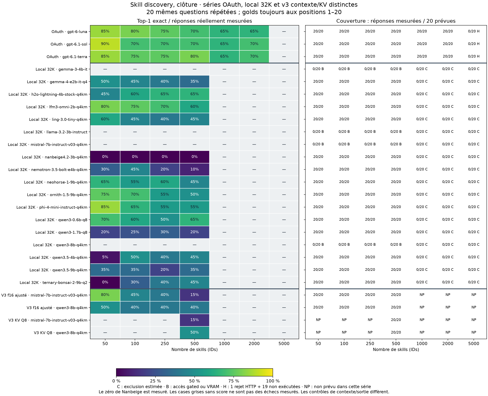

# Comparaison descriptive : bibliothèque identique, conditions d'inférence distinctes

Les nouvelles copies publiques préservent les réponses mesurées. Cette comparaison ne valide pas une équivalence API/OAuth/local : les locaux sont quantifiés, limités à 32K et 500 tokens de sortie, avec un adaptateur de réponse finale natif ; OAuth omet température/plafond de sortie et rapporte un raisonnement medium. Aucun nouveau modèle n'a été appelé.

Le graphique utilise les mêmes 20 questions à chaque taille. Chaque zéro coloré résulte de réponses effectivement mesurées ; les cases sans score signalent une exclusion, un blocage ou une taille non exécutée. Les erreurs de format et raisonnements sans réponse finale restent dans le dénominateur des sorties locales mesurées.

## Panneau commun N = 50, 100, 250, 500

Les scores ci-dessous utilisent 80 mesures par modèle exécuté, issues de 20 questions répétées sur quatre tailles. Les intervalles rééchantillonnent 20 blocs question avec leurs quatre tailles, 10 000 fois, graine 20261103. Ils sont descriptifs et conditionnels aux listes biaisées, sans interprétation comme 80 essais indépendants. Aucun intervalle n'est fourni aux modèles bloqués.

| Voie | Modèle | Mesures | Top-1 exact | Bootstrap par question, 95 % | Sorties sans erreur | Médiane LLM (s) |
| --- | --- | ---: | ---: | --- | ---: | ---: |
| local | gemma-3-4b-it | 0 | Non mesuré | — | 0 | — |
| local | gemma-4-e2b-it-q4 | 80 | 34/80 (42.5%) | 25.0% à 61.3% | 34 | 7.292 |
| local | h2o-lightning-4b-stock-q4km | 80 | 47/80 (58.8%) | 40.0% à 76.2% | 50 | 8.362 |
| local | lfm3-omni-2b-q4km | 80 | 57/80 (71.2%) | 53.8% à 87.5% | 75 | 2.036 |
| local | ling-3.0-tiny-q4km | 80 | 38/80 (47.5%) | 31.2% à 63.7% | 40 | 7.976 |
| local | llama-3.2-3b-instruct | 0 | Non mesuré | — | 0 | — |
| local | mistral-7b-instruct-v03-q4km | 0 | Non mesuré | — | 0 | — |
| local | nanbeige4.2-3b-q4km | 80 | 0/80 (0.0%) | 0.0% à 0.0% | 0 | 44.271 |
| local | nemotron-3.5-bolt-e4b-q4km | 80 | 21/80 (26.2%) | 15.0% à 38.8% | 21 | 9.637 |
| local | neohorse-1-9b-q4km | 80 | 45/80 (56.2%) | 36.2% à 75.0% | 46 | 12.655 |
| local | ornith-1.5-9b-q4km | 80 | 50/80 (62.5%) | 46.2% à 77.5% | 57 | 12.614 |
| local | phi-4-mini-instruct-q4km | 80 | 52/80 (65.0%) | 46.2% à 82.5% | 58 | 5.718 |
| local | qwen3-0.6b-q8 | 80 | 49/80 (61.3%) | 48.8% à 72.5% | 57 | 3.689 |
| local | qwen3-1.7b-q8 | 80 | 19/80 (23.8%) | 11.2% à 37.5% | 20 | 5.483 |
| local | qwen3-8b-q4km | 0 | Non mesuré | — | 0 | — |
| local | qwen3.5-4b-q4km | 80 | 28/80 (35.0%) | 22.5% à 47.5% | 32 | 8.854 |
| local | qwen3.5-9b-q4km | 80 | 25/80 (31.2%) | 17.5% à 46.2% | 27 | 13.490 |
| local | ternary-bonsai-2-9b-q2 | 80 | 23/80 (28.7%) | 17.5% à 40.0% | 25 | 10.925 |
| OAuth | gpt-6-luna | 80 | 62/80 (77.5%) | 60.0% à 92.5% | 80 | 2.593 |
| OAuth | gpt-6.1-sol | 80 | 60/80 (75.0%) | 56.2% à 91.2% | 80 | 5.239 |
| OAuth | gpt-6.1-terra | 80 | 63/80 (78.8%) | 61.3% à 95.0% | 80 | 2.758 |

## Limites et preuves

- **Biais de position :** tous les golds sont aux positions 1–20, avec la même graine que la sélection des questions. Les différences ne généralisent pas à des positions aléatoires ou centrales.
- **Couverture locale :** 14 modèles exécutés, 1 120 réponses avec usage réel ; quatre modèles sans inférence. Les 1 080 lignes de contexte estimé ne mesurent pas la fenêtre native maximale de chaque modèle.
- **Couverture OAuth :** 360 réponses mesurées à N ≤ 2000 ; N=5000 compte un rejet de longueur de chaîne HTTP et 19 non-exécutions par modèle, pas une limite de contexte en tokens établie.
- **Nanbeige :** ses 80 sorties mesurées restent sans réponse finale dans le budget 500 ; son zéro ne signifie pas une incapacité sémantique générale.
- **Matériel local :** transformer, sortie et KV sur CUDA, mais poids d’entrée/embeddings CPU_Mapped et préparation CPU conservés par llama.cpp b11960. Ce profil ne prouve pas une absence totale de calcul CPU. Voir [la portée matérielle](evidence/NATIVE_GPU_SCOPE.md).
- **Latence :** les temps locaux et HTTP OAuth incluent des travaux et longueurs de sortie différents. Aucun ratio de vitesse matérielle n’est revendiqué.
- **Définition native-v2 :** correction du parsing du raisonnement ; le protocole scientifique biaisé v1 reste inchangé. La v2 scientifique proposée dans le rapport OAuth n’a pas été exécutée.
- **Comparabilité externe :** la concordance avec le runner cloud de référence reste non vérifiée ; les noms dupliqués et indices lexicaux des questions demeurent.

[Rapport local](LOCAL_REPORT.md) · [Rapport OAuth](../skill-discovery-oauth-v1-20261103/REPORT.md) · [Validation hors ligne](validation/public-validation.json) · [Résumé du panneau commun](validation/common-panel-summary.csv)

Les CSV sont inchangés ; les bases distribuées sont des exports d’audit non reprisables. Les sorties HTTP privées complètes ne sont pas redistribuées, donc les vérifications publiques recalculent rangs/métriques/persistance sans rejouer chaque normalisation depuis le texte brut. Voir les transformations et empreintes pour les adaptations de confidentialité.

## Complément final Qwen8/Mistral : série v3 séparée

Les deux modèles ont fourni 200 réponses supplémentaires : 80 f16 par modèle à N=50/100/250/500, puis 20 Q8_0 par modèle à N=500. Le contexte est adapté aux tokens réels +500, sans la marge estimée de 10 % du lot initial. Les poids Q4_K_M sont inchangés ; Q8_0 désigne le cache KV. Les blocages 32K/f16 historiques restent conservés.

| Modèle | Profil | N | n_ctx | KV | Top-1 /20 | Top-10 /20 | Sans erreur | Médiane LLM (s) |
| --- | --- | ---: | ---: | --- | ---: | ---: | ---: | ---: |
| mistral-7b-instruct-v03-q4km | f16-adjusted-n100 | 100 | 5888 | f16 | 9 | 15 | 20 | 11.550 |
| mistral-7b-instruct-v03-q4km | f16-adjusted-n250 | 250 | 14080 | f16 | 8 | 12 | 19 | 20.081 |
| mistral-7b-instruct-v03-q4km | f16-adjusted-n50 | 50 | 3328 | f16 | 16 | 20 | 20 | 5.854 |
| mistral-7b-instruct-v03-q4km | f16-adjusted-n500 | 500 | 27392 | f16 | 3 | 10 | 19 | 37.395 |
| mistral-7b-instruct-v03-q4km | q8-adjusted-n500 | 500 | 27392 | q8_0 | 3 | 8 | 18 | 46.022 |
| qwen3-8b-q4km | f16-adjusted-n100 | 100 | 5120 | f16 | 8 | 8 | 8 | 11.937 |
| qwen3-8b-q4km | f16-adjusted-n250 | 250 | 12032 | f16 | 8 | 8 | 8 | 19.557 |
| qwen3-8b-q4km | f16-adjusted-n50 | 50 | 2816 | f16 | 10 | 10 | 10 | 9.938 |
| qwen3-8b-q4km | f16-adjusted-n500 | 500 | 23552 | f16 | 8 | 9 | 10 | 34.465 |
| qwen3-8b-q4km | q8-adjusted-n500 | 500 | 23552 | q8_0 | 10 | 10 | 11 | 42.221 |

| Comparaison appariée N=500 | Top-1 f16 → Q8 | Top-10 f16 → Q8 | f16 seul correct | Q8 seul correct |
| --- | --- | --- | ---: | ---: |
| qwen3-8b-q4km | 8 → 10 | 9 → 10 | 1 | 3 |
| mistral-7b-instruct-v03-q4km | 3 → 3 | 10 → 8 | 0 | 0 |

Sur les quatre tailles f16, Qwen8 atteint 34/80 (42,5 %) et Mistral 36/80 (45,0 %). Les résultats Q8 restent séparés. Les 20 questions appariées ne prouvent ni une amélioration générale ni une équivalence de quantification. Aucun N≥1000 n’a été mesuré dans ce complément.

Au total, 16 modèles locaux distincts ont maintenant des mesures dans au moins une série : 1 120 réponses dans le lot initial, plus 200 dans ce complément, soit 1 320. Les trois modèles OAuth ajoutent 360 réponses, soit 1 680 réponses mesurées tous profils confondus ; ces nombres ne sont pas des observations indépendantes. Llama 3.2 et Gemma 3 restent non exécutés à la clôture demandée.

[Rapport détaillé v3](profiles-v3/PROFILE_REPORT.md) · [Validation](profiles-v3/validation/public-validation.json) · [Clôture Llama/Gemma](profiles-v3/CLOSURE.md)

