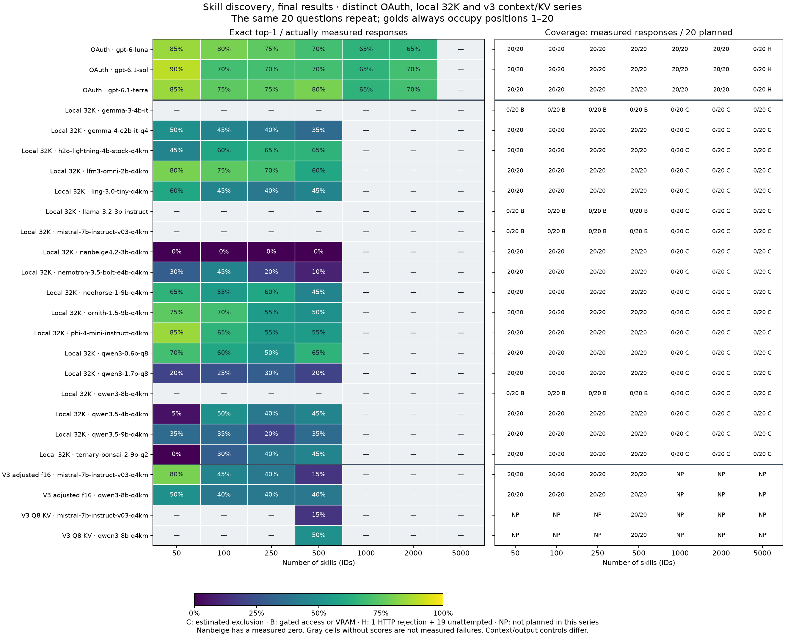
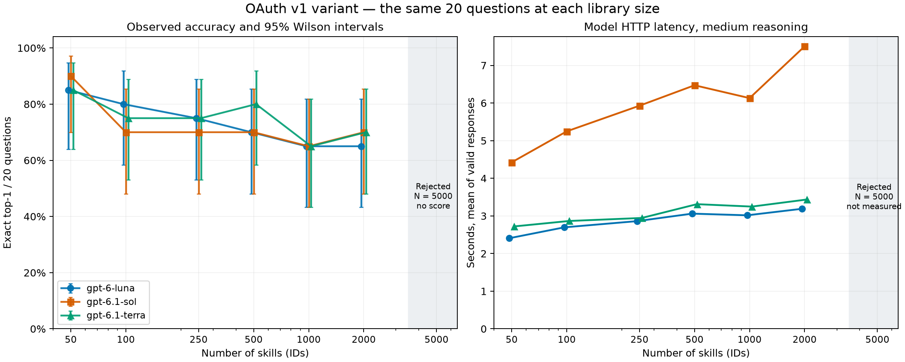

# Final report: local and OAuth skill discovery

The study closes with the available measurements. Sixteen distinct local models
produced measurements in at least one series: 1,120 responses in the initial series
and 200 in the Qwen8/Mistral supplement. Three OAuth models add 360 responses.
These 1,680 responses reuse the same 20 questions; they are not 1,680 independent
observations. Llama 3.2 and Gemma 3 remain unexecuted at the requested closure.

The series remain separate. The initial local series uses 32K/f16 and an estimated
context gate. The v3 supplement sizes n_ctx to actual input tokens +500 without the
10% margin, and compares Q8_0 KV with f16 at N=500. OAuth does not expose the same
temperature and output-length controls. Golds always occupy positions 1–20. Scores
describe these disclosed, position-biased conditions.

This report combines the coverage/uncertainty comparison, initial local results,
final profiles and OAuth analysis. Code, configurations, unchanged CSVs, sanitized
SQLite audit exports, MIT/Apache attribution for all 6,006 skills and file manifests
accompany the reports. Private raw captures, credentials, personal paths and live
runtime files are excluded. No model inference was rerun for translation.

All authored presentation text is English. Immutable multilingual benchmark data,
tokenizer vocabularies, recorded requests and exact executed-source snapshots retain
their original bytes, as documented in the
[language audit](https://github.com/speccy88/mia5150/blob/main/docs/publication/ENGLISH_LANGUAGE_AUDIT.md).


---

# Final comparison

# Descriptive comparison: identical libraries, distinct inference conditions

The public copies preserve measured outcomes. This comparison does not establish API/OAuth/local equivalence: local models are quantized, use a 32K window and 500-token output cap, and have a native final-answer adapter; OAuth omits temperature/output controls and reports medium reasoning. No new model calls were made for the comparison.



The plot uses the same 20 questions at each size. Every colored zero comes from actual measured outputs; missing scores indicate exclusions, blocks or unattempted sizes. Format errors and reasoning without final answers stay in the denominator of measured local outputs.

## Shared panel: N = 50, 100, 250, 500

These scores use 80 measurements per executed model: 20 questions repeated at four sizes. Intervals resample 20 question clusters with all four sizes together, 10,000 times, seed 20261103. They are descriptive and conditional on the biased lists, rather than treating 80 cases as independent. Blocked models receive no interval.

| Route | Model | Measurements | Top-1 exact | Question-cluster bootstrap, 95% | Outputs without errors | Median LLM (s) |
| --- | --- | ---: | ---: | --- | ---: | ---: |
| local | gemma-3-4b-it | 0 | Not measured | — | 0 | — |
| local | gemma-4-e2b-it-q4 | 80 | 34/80 (42.5%) | 25.0% to 61.3% | 34 | 7.292 |
| local | h2o-lightning-4b-stock-q4km | 80 | 47/80 (58.8%) | 40.0% to 76.2% | 50 | 8.362 |
| local | lfm3-omni-2b-q4km | 80 | 57/80 (71.2%) | 53.8% to 87.5% | 75 | 2.036 |
| local | ling-3.0-tiny-q4km | 80 | 38/80 (47.5%) | 31.2% to 63.7% | 40 | 7.976 |
| local | llama-3.2-3b-instruct | 0 | Not measured | — | 0 | — |
| local | mistral-7b-instruct-v03-q4km | 0 | Not measured | — | 0 | — |
| local | nanbeige4.2-3b-q4km | 80 | 0/80 (0.0%) | 0.0% to 0.0% | 0 | 44.271 |
| local | nemotron-3.5-bolt-e4b-q4km | 80 | 21/80 (26.2%) | 15.0% to 38.8% | 21 | 9.637 |
| local | neohorse-1-9b-q4km | 80 | 45/80 (56.2%) | 36.2% to 75.0% | 46 | 12.655 |
| local | ornith-1.5-9b-q4km | 80 | 50/80 (62.5%) | 46.2% to 77.5% | 57 | 12.614 |
| local | phi-4-mini-instruct-q4km | 80 | 52/80 (65.0%) | 46.2% to 82.5% | 58 | 5.718 |
| local | qwen3-0.6b-q8 | 80 | 49/80 (61.3%) | 48.8% to 72.5% | 57 | 3.689 |
| local | qwen3-1.7b-q8 | 80 | 19/80 (23.8%) | 11.2% to 37.5% | 20 | 5.483 |
| local | qwen3-8b-q4km | 0 | Not measured | — | 0 | — |
| local | qwen3.5-4b-q4km | 80 | 28/80 (35.0%) | 22.5% to 47.5% | 32 | 8.854 |
| local | qwen3.5-9b-q4km | 80 | 25/80 (31.2%) | 17.5% to 46.2% | 27 | 13.490 |
| local | ternary-bonsai-2-9b-q2 | 80 | 23/80 (28.7%) | 17.5% to 40.0% | 25 | 10.925 |
| OAuth | gpt-6-luna | 80 | 62/80 (77.5%) | 60.0% to 92.5% | 80 | 2.593 |
| OAuth | gpt-6.1-sol | 80 | 60/80 (75.0%) | 56.2% to 91.2% | 80 | 5.239 |
| OAuth | gpt-6.1-terra | 80 | 63/80 (78.8%) | 61.3% to 95.0% | 80 | 2.758 |

## Limitations and evidence

- **Position bias:** all golds occupy positions 1–20, using the same seed as question selection. Differences cannot be generalized to random or central positions.
- **Initial local coverage:** 14 models executed, 1,120 outputs with actual usage; four models without inference. The 1,080 estimated-context rows do not measure native maximum model windows.
- **OAuth coverage:** 360 measured responses at N≤2000. At N=5000 each model has one HTTP string-length rejection and 19 unattempted cases, rather than an established token-context limit.
- **Nanbeige:** all 80 measured outputs lack a final answer within the 500-token budget. Its zero does not establish a general semantic inability.
- **Local hardware:** transformer/output layers and KV are on CUDA, but llama.cpp b11960 retains CPU_Mapped input/embedding weights and CPU preparation. This profile does not demonstrate zero CPU participation. See [hardware scope](https://github.com/speccy88/mia5150/blob/main/experiments/benchmarks/skill-discovery-local-native-20261103/evidence/NATIVE_GPU_SCOPE.md).
- **Latency:** local and OAuth HTTP timings include different work and output lengths. No hardware-speed ratio is claimed.
- **Native-v2 definition:** this corrects reasoning parsing; the biased scientific v1 protocol is unchanged. The scientific v2 proposed in the OAuth report was not executed.
- **External comparability:** agreement with the reference cloud runner remains unverified; duplicate names and lexical query hints remain.

[Local report](https://github.com/speccy88/mia5150/blob/main/experiments/benchmarks/skill-discovery-local-native-20261103/LOCAL_REPORT.md) · [OAuth report](https://github.com/speccy88/mia5150/blob/main/experiments/benchmarks/skill-discovery-oauth-v1-20261103/REPORT.md) · [Offline validation](https://github.com/speccy88/mia5150/blob/main/experiments/benchmarks/skill-discovery-local-native-20261103/validation/public-validation.json) · [Shared-panel summary](https://github.com/speccy88/mia5150/blob/main/experiments/benchmarks/skill-discovery-local-native-20261103/validation/common-panel-summary.csv)

CSV bytes are unchanged. Distributed databases are nonresumable audit exports. Full private HTTP outputs are not redistributed, so public validation recomputes ranking metrics and persistence without replaying every normalization from raw text. Transformation records and hashes describe privacy adaptations.

## Final Qwen8/Mistral supplement: separate v3 series

The two models produced 200 additional responses: 80 f16 responses per model at N=50/100/250/500, then 20 Q8_0 responses per model at N=500. Context is sized to actual input tokens +500, without the initial estimated 10% margin. Q4_K_M weights are unchanged; Q8_0 refers to the KV cache. Historical 32K/f16 blocks remain preserved.

| Model | Profile | N | n_ctx | KV | Top-1 /20 | Top-10 /20 | Without errors | Median LLM (s) |
| --- | --- | ---: | ---: | --- | ---: | ---: | ---: | ---: |
| mistral-7b-instruct-v03-q4km | f16-adjusted-n100 | 100 | 5888 | f16 | 9 | 15 | 20 | 11.550 |
| mistral-7b-instruct-v03-q4km | f16-adjusted-n250 | 250 | 14080 | f16 | 8 | 12 | 19 | 20.081 |
| mistral-7b-instruct-v03-q4km | f16-adjusted-n50 | 50 | 3328 | f16 | 16 | 20 | 20 | 5.854 |
| mistral-7b-instruct-v03-q4km | f16-adjusted-n500 | 500 | 27392 | f16 | 3 | 10 | 19 | 37.395 |
| mistral-7b-instruct-v03-q4km | q8-adjusted-n500 | 500 | 27392 | q8_0 | 3 | 8 | 18 | 46.022 |
| qwen3-8b-q4km | f16-adjusted-n100 | 100 | 5120 | f16 | 8 | 8 | 8 | 11.937 |
| qwen3-8b-q4km | f16-adjusted-n250 | 250 | 12032 | f16 | 8 | 8 | 8 | 19.557 |
| qwen3-8b-q4km | f16-adjusted-n50 | 50 | 2816 | f16 | 10 | 10 | 10 | 9.938 |
| qwen3-8b-q4km | f16-adjusted-n500 | 500 | 23552 | f16 | 8 | 9 | 10 | 34.465 |
| qwen3-8b-q4km | q8-adjusted-n500 | 500 | 23552 | q8_0 | 10 | 10 | 11 | 42.221 |

| Paired comparison at N=500 | Top-1 f16 → Q8 | Top-10 f16 → Q8 | Only f16 correct | Only Q8 correct |
| --- | --- | --- | ---: | ---: |
| qwen3-8b-q4km | 8 → 10 | 9 → 10 | 1 | 3 |
| mistral-7b-instruct-v03-q4km | 3 → 3 | 10 → 8 | 0 | 0 |

Across the four f16 sizes, Qwen8 scores 34/80 (42.5%) and Mistral 36/80 (45.0%). Q8 results remain separate. The 20 paired questions establish neither a general improvement nor quantization equivalence. No N≥1000 case was measured in this supplement.

In total, 16 distinct local models now have measurements in at least one series: 1,120 responses in the initial series plus 200 in this supplement, or 1.320. Three OAuth models add 360 responses, giving 1,680 measured responses across profiles; these are not independent observations. Llama 3.2 and Gemma 3 remain unexecuted at the requested closure.

[Detailed v3 report](https://github.com/speccy88/mia5150/blob/main/experiments/benchmarks/skill-discovery-local-native-20261103/profiles-v3/PROFILE_REPORT.md) · [Validation](https://github.com/speccy88/mia5150/blob/main/experiments/benchmarks/skill-discovery-local-native-20261103/profiles-v3/validation/public-validation.json) · [Llama/Gemma closure](https://github.com/speccy88/mia5150/blob/main/experiments/benchmarks/skill-discovery-local-native-20261103/profiles-v3/CLOSURE.md)


---

# Initial local series: historical outcomes preserved

# Skill discovery — local results with the corrected native adapter

Status verified at 2026-11-03T09:52:39.825472+00:00. Suite: `completed`.

Of the 18 requested models, 14 produced measured responses. The series contains 2520 rows with 45 columns and 1120 responses with actual usage. Blocks and exclusions remain separate from measurements.

The comparative series is `results/local-native-v2/`. The earlier `local-v1/` series was preserved after four models as a diagnostic: its adapter could count internal reasoning as ranked answers. Its scores are not the final comparative results. See `evidence/NATIVE_PARSER_V2.md`.

## Model coverage

| Requested model | Status | Saved rows | Measured responses | Strict top-1 / measured responses | Top-10 / measured responses | Outputs without errors |
|---|---|---:|---:|---:|---:|---:|
| Qwen3-0.6B | completed | 140 | 80 | 49/80 (61.25%) | 51/80 (63.75%) | 57 |
| Qwen3-1.7B | completed | 140 | 80 | 19/80 (23.75%) | 19/80 (23.75%) | 20 |
| Qwen3.5-4B | completed | 140 | 80 | 28/80 (35.00%) | 30/80 (37.50%) | 32 |
| Ling-3.0-tiny | completed | 140 | 80 | 38/80 (47.50%) | 40/80 (50.00%) | 40 |
| Qwen3.5-9B | completed | 140 | 80 | 25/80 (31.25%) | 25/80 (31.25%) | 27 |
| Llama 3.2 3B | blocked: ACCESS_GATED_ACCEPTANCE_REQUIRED | 140 | 0 | - | - | 0 |
| Gemma 3 4B | blocked: ACCESS_GATED_ACCEPTANCE_REQUIRED | 140 | 0 | - | - | 0 |
| H2O-Lightning-4B | completed | 140 | 80 | 47/80 (58.75%) | 49/80 (61.25%) | 50 |
| Gemma 4 E2B | completed | 140 | 80 | 34/80 (42.50%) | 34/80 (42.50%) | 34 |
| Qwen3-8B | blocked: HARDWARE_VRAM_CAPACITY_EXCEEDED | 140 | 0 | - | - | 0 |
| NeoHorse-1-9B | completed | 140 | 80 | 45/80 (56.25%) | 45/80 (56.25%) | 46 |
| Ornith-1.5-9B | completed | 140 | 80 | 50/80 (62.50%) | 54/80 (67.50%) | 57 |
| Nemotron 3.5 Bolt E4B | completed | 140 | 80 | 21/80 (26.25%) | 21/80 (26.25%) | 21 |
| Ternary Bonsai 2 9B | completed | 140 | 80 | 23/80 (28.75%) | 25/80 (31.25%) | 25 |
| LFM3-Omni-2B | completed | 140 | 80 | 57/80 (71.25%) | 61/80 (76.25%) | 75 |
| Phi-4 Mini 3.8B | completed | 140 | 80 | 52/80 (65.00%) | 53/80 (66.25%) | 58 |
| Mistral 7B Instruct | blocked: HARDWARE_VRAM_CAPACITY_EXCEEDED | 140 | 0 | - | - | 0 |
| Nanbeige 4.2 3B | completed | 140 | 80 | 0/80 (0.00%) | 0/80 (0.00%) | 0 |

A measured response has actual input and output token usage. OOM, gated access, context exclusions and unattempted cases have no measured accuracy; they are not observed zero-accuracy results. A complete 140-row export does not imply 140 successful calls.

## Details by library size

| Model | N | Measured responses | Strict top-1 | Top-10 recall | Top-1 precision, non-error outputs | Outputs reaching the 500-token cap | Actual input tokens, min–max | Median LLM call (s) | Recorded issues |
|---|---:|---:|---:|---:|---:|---:|---:|---:|---|
| gemma-3-4b-it | 50 | 0 | - | - | - | 0 | - | - | ACCESS_GATED_ACCEPTANCE_REQUIRED=20 |
| gemma-3-4b-it | 100 | 0 | - | - | - | 0 | - | - | ACCESS_GATED_ACCEPTANCE_REQUIRED=20 |
| gemma-3-4b-it | 250 | 0 | - | - | - | 0 | - | - | ACCESS_GATED_ACCEPTANCE_REQUIRED=20 |
| gemma-3-4b-it | 500 | 0 | - | - | - | 0 | - | - | ACCESS_GATED_ACCEPTANCE_REQUIRED=20 |
| gemma-3-4b-it | 1000 | 0 | - | - | - | 0 | - | - | CONTEXT_LIMIT_ESTIMATED=20 |
| gemma-3-4b-it | 2000 | 0 | - | - | - | 0 | - | - | CONTEXT_LIMIT_ESTIMATED=20 |
| gemma-3-4b-it | 5000 | 0 | - | - | - | 0 | - | - | CONTEXT_LIMIT_ESTIMATED=20 |
| gemma-4-e2b-it-q4 | 50 | 20 | 50.00% | 50.00% | 100.00% | 9 | 2247-2298 | 4.98 | REASONING_NO_FINAL_ANSWER=9, OK=10, INVALID_OUTPUT=1 |
| gemma-4-e2b-it-q4 | 100 | 20 | 45.00% | 45.00% | 100.00% | 11 | 4480-4531 | 5.88 | REASONING_NO_FINAL_ANSWER=11, OK=9 |
| gemma-4-e2b-it-q4 | 250 | 20 | 40.00% | 40.00% | 100.00% | 12 | 11787-11838 | 8.59 | REASONING_NO_FINAL_ANSWER=12, OK=8 |
| gemma-4-e2b-it-q4 | 500 | 20 | 35.00% | 35.00% | 100.00% | 12 | 23499-23550 | 13.93 | REASONING_NO_FINAL_ANSWER=12, OK=7, INVALID_OUTPUT=1 |
| gemma-4-e2b-it-q4 | 1000 | 0 | - | - | - | 0 | - | - | CONTEXT_LIMIT_ESTIMATED=20 |
| gemma-4-e2b-it-q4 | 2000 | 0 | - | - | - | 0 | - | - | CONTEXT_LIMIT_ESTIMATED=20 |
| gemma-4-e2b-it-q4 | 5000 | 0 | - | - | - | 0 | - | - | CONTEXT_LIMIT_ESTIMATED=20 |
| h2o-lightning-4b-stock-q4km | 50 | 20 | 45.00% | 45.00% | 100.00% | 11 | 2239-2292 | 7.10 | REASONING_NO_FINAL_ANSWER=7, OK=9, MALFORMED_REASONING_BOUNDARY=2, INVALID_OUTPUT=2 |
| h2o-lightning-4b-stock-q4km | 100 | 20 | 60.00% | 70.00% | 85.71% | 9 | 4415-4468 | 6.70 | REASONING_NO_FINAL_ANSWER=5, OK=14, MALFORMED_REASONING_BOUNDARY=1 |
| h2o-lightning-4b-stock-q4km | 250 | 20 | 65.00% | 65.00% | 100.00% | 10 | 11633-11686 | 10.94 | REASONING_NO_FINAL_ANSWER=6, OK=13, MALFORMED_REASONING_BOUNDARY=1 |
| h2o-lightning-4b-stock-q4km | 500 | 20 | 65.00% | 65.00% | 92.86% | 11 | 23177-23230 | 20.71 | REASONING_NO_FINAL_ANSWER=6, OK=14 |
| h2o-lightning-4b-stock-q4km | 1000 | 0 | - | - | - | 0 | - | - | CONTEXT_LIMIT_ESTIMATED=20 |
| h2o-lightning-4b-stock-q4km | 2000 | 0 | - | - | - | 0 | - | - | CONTEXT_LIMIT_ESTIMATED=20 |
| h2o-lightning-4b-stock-q4km | 5000 | 0 | - | - | - | 0 | - | - | CONTEXT_LIMIT_ESTIMATED=20 |
| lfm3-omni-2b-q4km | 50 | 20 | 80.00% | 80.00% | 84.21% | 0 | 2251-2306 | 0.59 | OK=19, INVALID_OUTPUT=1 |
| lfm3-omni-2b-q4km | 100 | 20 | 75.00% | 80.00% | 75.00% | 0 | 4457-4512 | 1.10 | OK=20 |
| lfm3-omni-2b-q4km | 250 | 20 | 70.00% | 75.00% | 73.68% | 0 | 11651-11706 | 2.96 | OK=19, INVALID_OUTPUT=1 |
| lfm3-omni-2b-q4km | 500 | 20 | 60.00% | 70.00% | 70.59% | 0 | 23137-23192 | 5.96 | OK=17, INVALID_OUTPUT=3 |
| lfm3-omni-2b-q4km | 1000 | 0 | - | - | - | 0 | - | - | CONTEXT_LIMIT_ESTIMATED=20 |
| lfm3-omni-2b-q4km | 2000 | 0 | - | - | - | 0 | - | - | CONTEXT_LIMIT_ESTIMATED=20 |
| lfm3-omni-2b-q4km | 5000 | 0 | - | - | - | 0 | - | - | CONTEXT_LIMIT_ESTIMATED=20 |
| ling-3.0-tiny-q4km | 50 | 20 | 60.00% | 65.00% | 92.31% | 8 | 2245-2296 | 3.31 | OK=13, REASONING_NO_FINAL_ANSWER=7 |
| ling-3.0-tiny-q4km | 100 | 20 | 45.00% | 50.00% | 90.00% | 10 | 4446-4497 | 6.47 | OK=10, REASONING_NO_FINAL_ANSWER=10 |
| ling-3.0-tiny-q4km | 250 | 20 | 40.00% | 40.00% | 100.00% | 14 | 11706-11757 | 11.89 | OK=8, REASONING_NO_FINAL_ANSWER=12 |
| ling-3.0-tiny-q4km | 500 | 20 | 45.00% | 45.00% | 100.00% | 10 | 23299-23350 | 21.55 | OK=9, REASONING_NO_FINAL_ANSWER=10, INVALID_OUTPUT=1 |
| ling-3.0-tiny-q4km | 1000 | 0 | - | - | - | 0 | - | - | CONTEXT_LIMIT_ESTIMATED=20 |
| ling-3.0-tiny-q4km | 2000 | 0 | - | - | - | 0 | - | - | CONTEXT_LIMIT_ESTIMATED=20 |
| ling-3.0-tiny-q4km | 5000 | 0 | - | - | - | 0 | - | - | CONTEXT_LIMIT_ESTIMATED=20 |
| llama-3.2-3b-instruct | 50 | 0 | - | - | - | 0 | - | - | ACCESS_GATED_ACCEPTANCE_REQUIRED=20 |
| llama-3.2-3b-instruct | 100 | 0 | - | - | - | 0 | - | - | ACCESS_GATED_ACCEPTANCE_REQUIRED=20 |
| llama-3.2-3b-instruct | 250 | 0 | - | - | - | 0 | - | - | ACCESS_GATED_ACCEPTANCE_REQUIRED=20 |
| llama-3.2-3b-instruct | 500 | 0 | - | - | - | 0 | - | - | ACCESS_GATED_ACCEPTANCE_REQUIRED=20 |
| llama-3.2-3b-instruct | 1000 | 0 | - | - | - | 0 | - | - | CONTEXT_LIMIT_ESTIMATED=20 |
| llama-3.2-3b-instruct | 2000 | 0 | - | - | - | 0 | - | - | CONTEXT_LIMIT_ESTIMATED=20 |
| llama-3.2-3b-instruct | 5000 | 0 | - | - | - | 0 | - | - | CONTEXT_LIMIT_ESTIMATED=20 |
| mistral-7b-instruct-v03-q4km | 50 | 0 | - | - | - | 0 | - | - | HARDWARE_VRAM_CAPACITY_EXCEEDED=20 |
| mistral-7b-instruct-v03-q4km | 100 | 0 | - | - | - | 0 | - | - | HARDWARE_VRAM_CAPACITY_EXCEEDED=20 |
| mistral-7b-instruct-v03-q4km | 250 | 0 | - | - | - | 0 | - | - | HARDWARE_VRAM_CAPACITY_EXCEEDED=20 |
| mistral-7b-instruct-v03-q4km | 500 | 0 | - | - | - | 0 | - | - | HARDWARE_VRAM_CAPACITY_EXCEEDED=20 |
| mistral-7b-instruct-v03-q4km | 1000 | 0 | - | - | - | 0 | - | - | CONTEXT_LIMIT_ESTIMATED=20 |
| mistral-7b-instruct-v03-q4km | 2000 | 0 | - | - | - | 0 | - | - | CONTEXT_LIMIT_ESTIMATED=20 |
| mistral-7b-instruct-v03-q4km | 5000 | 0 | - | - | - | 0 | - | - | CONTEXT_LIMIT_ESTIMATED=20 |
| nanbeige4.2-3b-q4km | 50 | 20 | 0.00% | 0.00% | - | 20 | 2275-2326 | 17.30 | REASONING_NO_FINAL_ANSWER=20 |
| nanbeige4.2-3b-q4km | 100 | 20 | 0.00% | 0.00% | - | 20 | 4519-4570 | 27.21 | REASONING_NO_FINAL_ANSWER=20 |
| nanbeige4.2-3b-q4km | 250 | 20 | 0.00% | 0.00% | - | 20 | 11910-11961 | 61.31 | REASONING_NO_FINAL_ANSWER=20 |
| nanbeige4.2-3b-q4km | 500 | 20 | 0.00% | 0.00% | - | 20 | 23750-23801 | 122.00 | REASONING_NO_FINAL_ANSWER=20 |
| nanbeige4.2-3b-q4km | 1000 | 0 | - | - | - | 0 | - | - | CONTEXT_LIMIT_ESTIMATED=20 |
| nanbeige4.2-3b-q4km | 2000 | 0 | - | - | - | 0 | - | - | CONTEXT_LIMIT_ESTIMATED=20 |
| nanbeige4.2-3b-q4km | 5000 | 0 | - | - | - | 0 | - | - | CONTEXT_LIMIT_ESTIMATED=20 |
| nemotron-3.5-bolt-e4b-q4km | 50 | 20 | 30.00% | 30.00% | 100.00% | 14 | 2247-2298 | 8.23 | OK=6, REASONING_NO_FINAL_ANSWER=14 |
| nemotron-3.5-bolt-e4b-q4km | 100 | 20 | 45.00% | 45.00% | 100.00% | 12 | 4480-4531 | 9.57 | OK=9, REASONING_NO_FINAL_ANSWER=11 |
| nemotron-3.5-bolt-e4b-q4km | 250 | 20 | 20.00% | 20.00% | 100.00% | 16 | 11787-11838 | 14.30 | REASONING_NO_FINAL_ANSWER=16, OK=4 |
| nemotron-3.5-bolt-e4b-q4km | 500 | 20 | 10.00% | 10.00% | 100.00% | 18 | 23499-23550 | 22.73 | REASONING_NO_FINAL_ANSWER=18, OK=2 |
| nemotron-3.5-bolt-e4b-q4km | 1000 | 0 | - | - | - | 0 | - | - | CONTEXT_LIMIT_ESTIMATED=20 |
| nemotron-3.5-bolt-e4b-q4km | 2000 | 0 | - | - | - | 0 | - | - | CONTEXT_LIMIT_ESTIMATED=20 |
| nemotron-3.5-bolt-e4b-q4km | 5000 | 0 | - | - | - | 0 | - | - | CONTEXT_LIMIT_ESTIMATED=20 |
| neohorse-1-9b-q4km | 50 | 20 | 65.00% | 65.00% | 100.00% | 7 | 2239-2292 | 6.43 | OK=13, REASONING_NO_FINAL_ANSWER=6, INVALID_OUTPUT=1 |
| neohorse-1-9b-q4km | 100 | 20 | 55.00% | 55.00% | 100.00% | 9 | 4415-4468 | 7.54 | REASONING_NO_FINAL_ANSWER=9, OK=11 |
| neohorse-1-9b-q4km | 250 | 20 | 60.00% | 60.00% | 100.00% | 8 | 11633-11686 | 16.46 | REASONING_NO_FINAL_ANSWER=8, OK=12 |
| neohorse-1-9b-q4km | 500 | 20 | 45.00% | 45.00% | 90.00% | 11 | 23177-23230 | 29.74 | REASONING_NO_FINAL_ANSWER=10, OK=10 |
| neohorse-1-9b-q4km | 1000 | 0 | - | - | - | 0 | - | - | CONTEXT_LIMIT_ESTIMATED=20 |
| neohorse-1-9b-q4km | 2000 | 0 | - | - | - | 0 | - | - | CONTEXT_LIMIT_ESTIMATED=20 |
| neohorse-1-9b-q4km | 5000 | 0 | - | - | - | 0 | - | - | CONTEXT_LIMIT_ESTIMATED=20 |
| ornith-1.5-9b-q4km | 50 | 20 | 75.00% | 85.00% | 88.24% | 3 | 2239-2292 | 7.69 | OK=17, REASONING_NO_FINAL_ANSWER=2, INVALID_OUTPUT=1 |
| ornith-1.5-9b-q4km | 100 | 20 | 70.00% | 75.00% | 87.50% | 5 | 4415-4468 | 9.39 | REASONING_NO_FINAL_ANSWER=4, OK=16 |
| ornith-1.5-9b-q4km | 250 | 20 | 55.00% | 55.00% | 100.00% | 10 | 11633-11686 | 18.63 | OK=11, REASONING_NO_FINAL_ANSWER=9 |
| ornith-1.5-9b-q4km | 500 | 20 | 50.00% | 55.00% | 76.92% | 9 | 23177-23230 | 29.49 | OK=13, REASONING_NO_FINAL_ANSWER=7 |
| ornith-1.5-9b-q4km | 1000 | 0 | - | - | - | 0 | - | - | CONTEXT_LIMIT_ESTIMATED=20 |
| ornith-1.5-9b-q4km | 2000 | 0 | - | - | - | 0 | - | - | CONTEXT_LIMIT_ESTIMATED=20 |
| ornith-1.5-9b-q4km | 5000 | 0 | - | - | - | 0 | - | - | CONTEXT_LIMIT_ESTIMATED=20 |
| phi-4-mini-instruct-q4km | 50 | 20 | 85.00% | 85.00% | 85.00% | 1 | 2127-2180 | 1.56 | OK=20 |
| phi-4-mini-instruct-q4km | 100 | 20 | 65.00% | 65.00% | 86.67% | 0 | 4221-4274 | 2.33 | OK=15, INVALID_OUTPUT=5 |
| phi-4-mini-instruct-q4km | 250 | 20 | 55.00% | 60.00% | 91.67% | 2 | 11019-11072 | 6.28 | OK=12, INVALID_OUTPUT=8 |
| phi-4-mini-instruct-q4km | 500 | 20 | 55.00% | 55.00% | 100.00% | 2 | 21852-21905 | 14.51 | OK=11, INVALID_OUTPUT=9 |
| phi-4-mini-instruct-q4km | 1000 | 0 | - | - | - | 0 | - | - | CONTEXT_LIMIT_ESTIMATED=20 |
| phi-4-mini-instruct-q4km | 2000 | 0 | - | - | - | 0 | - | - | CONTEXT_LIMIT_ESTIMATED=20 |
| phi-4-mini-instruct-q4km | 5000 | 0 | - | - | - | 0 | - | - | CONTEXT_LIMIT_ESTIMATED=20 |
| qwen3-0.6b-q8 | 50 | 20 | 70.00% | 75.00% | 93.33% | 6 | 2199-2252 | 1.92 | OK=15, REASONING_NO_FINAL_ANSWER=4, INVALID_OUTPUT=1 |
| qwen3-0.6b-q8 | 100 | 20 | 60.00% | 60.00% | 92.31% | 7 | 4334-4387 | 2.36 | OK=13, REASONING_NO_FINAL_ANSWER=6, INVALID_OUTPUT=1 |
| qwen3-0.6b-q8 | 250 | 20 | 50.00% | 55.00% | 76.92% | 6 | 11473-11526 | 4.94 | REASONING_NO_FINAL_ANSWER=6, OK=13, INVALID_OUTPUT=1 |
| qwen3-0.6b-q8 | 500 | 20 | 65.00% | 65.00% | 81.25% | 4 | 22878-22931 | 9.48 | OK=16, REASONING_NO_FINAL_ANSWER=2, INVALID_OUTPUT=2 |
| qwen3-0.6b-q8 | 1000 | 0 | - | - | - | 0 | - | - | CONTEXT_LIMIT_ESTIMATED=20 |
| qwen3-0.6b-q8 | 2000 | 0 | - | - | - | 0 | - | - | CONTEXT_LIMIT_ESTIMATED=20 |
| qwen3-0.6b-q8 | 5000 | 0 | - | - | - | 0 | - | - | CONTEXT_LIMIT_ESTIMATED=20 |
| qwen3-1.7b-q8 | 50 | 20 | 20.00% | 20.00% | 100.00% | 16 | 2199-2252 | 4.50 | REASONING_NO_FINAL_ANSWER=16, OK=4 |
| qwen3-1.7b-q8 | 100 | 20 | 25.00% | 25.00% | 100.00% | 15 | 4334-4387 | 5.27 | REASONING_NO_FINAL_ANSWER=15, OK=5 |
| qwen3-1.7b-q8 | 250 | 20 | 30.00% | 30.00% | 85.71% | 14 | 11473-11526 | 8.31 | REASONING_NO_FINAL_ANSWER=13, OK=7 |
| qwen3-1.7b-q8 | 500 | 20 | 20.00% | 20.00% | 100.00% | 16 | 22878-22931 | 14.32 | REASONING_NO_FINAL_ANSWER=15, OK=4, INVALID_OUTPUT=1 |
| qwen3-1.7b-q8 | 1000 | 0 | - | - | - | 0 | - | - | CONTEXT_LIMIT_ESTIMATED=20 |
| qwen3-1.7b-q8 | 2000 | 0 | - | - | - | 0 | - | - | CONTEXT_LIMIT_ESTIMATED=20 |
| qwen3-1.7b-q8 | 5000 | 0 | - | - | - | 0 | - | - | CONTEXT_LIMIT_ESTIMATED=20 |
| qwen3-8b-q4km | 50 | 0 | - | - | - | 0 | - | - | HARDWARE_VRAM_CAPACITY_EXCEEDED=20 |
| qwen3-8b-q4km | 100 | 0 | - | - | - | 0 | - | - | HARDWARE_VRAM_CAPACITY_EXCEEDED=20 |
| qwen3-8b-q4km | 250 | 0 | - | - | - | 0 | - | - | HARDWARE_VRAM_CAPACITY_EXCEEDED=20 |
| qwen3-8b-q4km | 500 | 0 | - | - | - | 0 | - | - | HARDWARE_VRAM_CAPACITY_EXCEEDED=20 |
| qwen3-8b-q4km | 1000 | 0 | - | - | - | 0 | - | - | CONTEXT_LIMIT_ESTIMATED=20 |
| qwen3-8b-q4km | 2000 | 0 | - | - | - | 0 | - | - | CONTEXT_LIMIT_ESTIMATED=20 |
| qwen3-8b-q4km | 5000 | 0 | - | - | - | 0 | - | - | CONTEXT_LIMIT_ESTIMATED=20 |
| qwen3.5-4b-q4km | 50 | 20 | 5.00% | 5.00% | 100.00% | 19 | 2239-2292 | 7.08 | REASONING_NO_FINAL_ANSWER=19, OK=1 |
| qwen3.5-4b-q4km | 100 | 20 | 50.00% | 55.00% | 83.33% | 14 | 4415-4468 | 8.27 | OK=12, REASONING_NO_FINAL_ANSWER=8 |
| qwen3.5-4b-q4km | 250 | 20 | 40.00% | 40.00% | 100.00% | 16 | 11633-11686 | 12.70 | OK=8, REASONING_NO_FINAL_ANSWER=12 |
| qwen3.5-4b-q4km | 500 | 20 | 45.00% | 50.00% | 81.82% | 13 | 23177-23230 | 20.62 | OK=11, REASONING_NO_FINAL_ANSWER=8, INVALID_OUTPUT=1 |
| qwen3.5-4b-q4km | 1000 | 0 | - | - | - | 0 | - | - | CONTEXT_LIMIT_ESTIMATED=20 |
| qwen3.5-4b-q4km | 2000 | 0 | - | - | - | 0 | - | - | CONTEXT_LIMIT_ESTIMATED=20 |
| qwen3.5-4b-q4km | 5000 | 0 | - | - | - | 0 | - | - | CONTEXT_LIMIT_ESTIMATED=20 |
| qwen3.5-9b-q4km | 50 | 20 | 35.00% | 35.00% | 100.00% | 14 | 2239-2292 | 10.85 | REASONING_NO_FINAL_ANSWER=13, OK=7 |
| qwen3.5-9b-q4km | 100 | 20 | 35.00% | 35.00% | 100.00% | 14 | 4415-4468 | 12.61 | REASONING_NO_FINAL_ANSWER=13, OK=7 |
| qwen3.5-9b-q4km | 250 | 20 | 20.00% | 20.00% | 100.00% | 16 | 11633-11686 | 18.88 | REASONING_NO_FINAL_ANSWER=16, OK=4 |
| qwen3.5-9b-q4km | 500 | 20 | 35.00% | 35.00% | 77.78% | 16 | 23177-23230 | 29.81 | OK=9, REASONING_NO_FINAL_ANSWER=11 |
| qwen3.5-9b-q4km | 1000 | 0 | - | - | - | 0 | - | - | CONTEXT_LIMIT_ESTIMATED=20 |
| qwen3.5-9b-q4km | 2000 | 0 | - | - | - | 0 | - | - | CONTEXT_LIMIT_ESTIMATED=20 |
| qwen3.5-9b-q4km | 5000 | 0 | - | - | - | 0 | - | - | CONTEXT_LIMIT_ESTIMATED=20 |
| ternary-bonsai-2-9b-q2 | 50 | 20 | 0.00% | 0.00% | - | 20 | 2239-2292 | 8.86 | REASONING_NO_FINAL_ANSWER=20 |
| ternary-bonsai-2-9b-q2 | 100 | 20 | 30.00% | 40.00% | 75.00% | 15 | 4415-4468 | 10.51 | OK=8, REASONING_NO_FINAL_ANSWER=12 |
| ternary-bonsai-2-9b-q2 | 250 | 20 | 40.00% | 40.00% | 100.00% | 13 | 11633-11686 | 16.28 | OK=8, REASONING_NO_FINAL_ANSWER=12 |
| ternary-bonsai-2-9b-q2 | 500 | 20 | 45.00% | 45.00% | 100.00% | 12 | 23177-23230 | 26.57 | INVALID_OUTPUT=1, OK=9, REASONING_NO_FINAL_ANSWER=10 |
| ternary-bonsai-2-9b-q2 | 1000 | 0 | - | - | - | 0 | - | - | CONTEXT_LIMIT_ESTIMATED=20 |
| ternary-bonsai-2-9b-q2 | 2000 | 0 | - | - | - | 0 | - | - | CONTEXT_LIMIT_ESTIMATED=20 |
| ternary-bonsai-2-9b-q2 | 5000 | 0 | - | - | - | 0 | - | - | CONTEXT_LIMIT_ESTIMATED=20 |

Rates over measured outputs include missing final lists and formatting failures. Precision conditional on non-error outputs uses another denominator. Errors and invalid final-answer ranks are never removed to promote a correct answer.

## Shared conditions and limitations

- 6,006 skills, 5,801 distinct names and the 20 exact questions; sizes 50, 100, 250, 500, 1,000, 2,000 and 5,000; seed 42; top 10. No full bodies: names and descriptions capped at 300 characters.
- `random.Random(42).sample(all_skills,N)` is restarted at each size. Each question gets a copy, with last-item replacement if and only if its gold ID is missing. **Verified intrinsic bias: the 20 supplied gold IDs are already the first 20 seed-42 draws; their positions remain 1–20 at every size.** The runner adds no gold prefix. This is not a test of uniformly distributed answer positions.
- All 140 v1/native-v2 candidate plans and prompt hashes are identical. The corrected adapter only adds parsing state for reasoning already prefilled by the template; prompts and thinking mode are unchanged. Delimited internal blocks are excluded from ranks. An unfinished reasoning block at the cap produces `REASONING_NO_FINAL_ANSWER` while retaining actual usage.
- RTX 2060 SUPER, 8,192 MiB; driver 610.88; llama.cpp b11960 CUDA 12.4. Transformer/output layers, f16 KV and observed recurrent state are on CUDA. Effective context 32,768, one slot, fit=off, no context shift, warmup, RAM cache or checkpoints; batch 512 / microbatch 128. **Exact scope: llama.cpp retains default CPU_Mapped input/embedding weights**, even with all transformer/output layers on GPU. This profile is not CPU-free computation. Transformer-layer fallback to fit VRAM is rejected. The buffer audit records these allocations. Preparatory conversion and quantization also use CPU.
- `/apply-template` then `/tokenize` provide actual counts; IDs are sent to `/completion`. Temperature 0, seed 42, 500-token output cap, no truncation. The estimated v1 gate `44.5*N+200 > 90% of context` excludes 60 rows at sizes 1,000/2,000/5,000; those are not measured input-token counts.
- **The 60 rows reflect the chosen n_ctx filter, not intrinsic model limits.** Qwen3.5 advertises 262,144 native tokens (an extension to 1,010,000); Ling configures 131,072 native tokens and a YaRN recipe for 262.144. This series loads only 32,768, a uniform conservative choice without per-model maximum-VRAM search. No tokenizer request or inference measures excluded sizes. Published windows, publisher configs, GGUF values and observed n_ctx are separated in the context-window audit and notes.
- Reasoning models can spend all 500 tokens before the final list. Budget/format failures describe this configuration, not their best possible ability. Quantization differs and is identified per model.
- Multimodal models are tested with text only. H2O uses its official ordinary-chat export without a typed-decision shim. Instruct/IT versions are used when available; Mistral is explicitly v0.3.
- The 20 questions form a small, partly lexical sample; duplicate names prevent recovery of some gold IDs through name-only responses. The original reference cloud runner was not supplied.
- OAuth Luna/Sol/Terra uses the same candidates, but its route guarantees neither temperature 0 nor a 500-token output cap. It remains a separate variant; strict cross-route equivalence is not claimed.
- Latencies describe this Windows environment with 16 GB RAM. Downloads and CPU conversions could run concurrently, so this is not an isolated speed benchmark. Local service charges are USD 0, excluding electricity.

## Weights and provenance

| Model | Quantization | Verified source |
|---|---|---|
| Qwen3-0.6B | Q8_0 | [Qwen/Qwen3-0.6B-GGUF](https://huggingface.co/Qwen/Qwen3-0.6B-GGUF) |
| Qwen3-1.7B | Q8_0 | [Qwen/Qwen3-1.7B-GGUF](https://huggingface.co/Qwen/Qwen3-1.7B-GGUF) |
| Qwen3.5-4B | Q4_K_M; installed Ollama artifact, digest confirmed against the official registry | [Qwen/Qwen3.5-4B](https://huggingface.co/Qwen/Qwen3.5-4B) |
| Ling-3.0-tiny | Q4_K_M | [inclusionAI/Ling-3.0-tiny-GGUF](https://huggingface.co/inclusionAI/Ling-3.0-tiny-GGUF) |
| Qwen3.5-9B | Q4_K_M; installed Ollama artifact, digest confirmed against the official registry | [Qwen/Qwen3.5-9B](https://huggingface.co/Qwen/Qwen3.5-9B) |
| Llama 3.2 3B | not downloaded: gated access | [meta-llama/Llama-3.2-3B-Instruct](https://huggingface.co/meta-llama/Llama-3.2-3B-Instruct) |
| Gemma 3 4B | not downloaded: gated access | [google/gemma-3-4b-it](https://huggingface.co/google/gemma-3-4b-it) |
| H2O-Lightning-4B | Q4_K_M, official stock ordinary-chat export | [h2oai/h2o-lightning-4b-gguf](https://huggingface.co/h2oai/h2o-lightning-4b-gguf) |
| Gemma 4 E2B | Official QAT Q4_0 | [google/gemma-4-E2B-it-qat-q4_0-gguf](https://huggingface.co/google/gemma-4-E2B-it-qat-q4_0-gguf) |
| Qwen3-8B | Q4_K_M | [Qwen/Qwen3-8B-GGUF](https://huggingface.co/Qwen/Qwen3-8B-GGUF) |
| NeoHorse-1-9B | Q4_K_M | [TokenRhythm/NeoHorse-1-9B-GGUF](https://huggingface.co/TokenRhythm/NeoHorse-1-9B-GGUF) |
| Ornith-1.5-9B | Q4_K_M | [ornith-ai/Ornith-1.5-9B-GGUF](https://huggingface.co/ornith-ai/Ornith-1.5-9B-GGUF) |
| Nemotron 3.5 Bolt E4B | Q4_K_M | [nvidia/NVIDIA-Nemotron-3.5-Bolt-E4B-4GB](https://huggingface.co/nvidia/NVIDIA-Nemotron-3.5-Bolt-E4B-4GB) |
| Ternary Bonsai 2 9B | Official ternary Q2_0 packing, not Q4 | [prism-ml/Ternary-Bonsai-2-9B-gguf](https://huggingface.co/prism-ml/Ternary-Bonsai-2-9B-gguf) |
| LFM3-Omni-2B | Q4_K_M | [LiquidAI/LFM3-Omni-2B-GGUF](https://huggingface.co/LiquidAI/LFM3-Omni-2B-GGUF) |
| Phi-4 Mini 3.8B | Q4_K_M, local conversion of pinned official weights | [microsoft/Phi-4-mini-instruct](https://huggingface.co/microsoft/Phi-4-mini-instruct) |
| Mistral 7B Instruct | Q4_K_M, local conversion of pinned official weights | [mistralai/Mistral-7B-Instruct-v0.3](https://huggingface.co/mistralai/Mistral-7B-Instruct-v0.3) |
| Nanbeige 4.2 3B | Q4_K_M, local conversion of pinned official weights | [Nanbeige/Nanbeige4.2-3B](https://huggingface.co/Nanbeige/Nanbeige4.2-3B) |

Commits, hashes, sizes and licenses are recorded in source inventories, verified Ollama manifests and weight provenance files. Installed Ling matches the official GGUF. Llama 3.2 3B and Gemma 3 4B require manual gated-access acceptance; no bypass or ungated substitute was used.

## Evidence, validation and delivery

All 34 synthetic tests pass, including seven native-parser regressions. `evidence/result-review-native-v2.json` checks the 45 columns, unique keys, cardinalities, actual usage, SQLite integrity and CSV/SQLite equality, and independently recalculates rank metrics. SQLite is the transactional authority; CSV is replaced atomically after each row.

Each model retains configuration, manifest and source-linked launch/GPU evidence. Initial failures are preserved. Raw outputs are held in ignored private response captures, without full prompts; no OAuth credential was copied into this local series. Public exports remove process identifiers and private paths while retaining audit hashes.

The benchmark/report generators do not send email or push code. Weights, archives, tools, environments, private full input files and raw captures are excluded. Public integration and the consolidated Markdown report are handled separately.

## Physical-VRAM admission

Under Windows WDDM, CUDA allocation can succeed despite a declared budget exceeding physical VRAM. The launcher therefore checks the sum of model, KV, recurrent-state and maximum compute CUDA buffers before inference. Excess produces `HARDWARE_VRAM_CAPACITY_EXCEEDED`, distinct from an observed CUDA OOM. It does not silently offload layers or change context.

Qwen3-8B at 32K declares 9,097.34 MiB against 8,192 MiB physical VRAM. The 21 responses acquired before this control remain in `results/diagnostic-vram-oversubscription/`, with the next unresolved intent unreplayed. They are excluded from the comparative series; its canonical ledger records hardware outcomes without measured accuracy. Corrected guard validation rejected the same load without inference. Exact launch hashes and allocations are audited in the native-buffer evidence.

Mistral-7B-Instruct-v0.3 is likewise rejected before generation: 8,230.52 MiB declared against 8,192 MiB physical VRAM. It is not assigned an observed zero; measured accuracy is absent. Converted originals and startup allocations are preserved.

Starting with Ornith, historical WDDM telemetry and its summary record verified-process dedicated/shared counters. Nonzero shared usage can include host allocations or driver staging; alone it proves neither transformer offload nor paging of a specific CUDA buffer. This sampled collection cannot reconstruct residency for earlier models.

Consolidated public provenance, including local conversions and installed Ollama artifacts, is in `evidence/model-artifact-provenance.json`. It remains available when ignored weight directories are not transferred.


---

# Qwen8/Mistral context and KV supplement: separate v3 series

# Separate local context and KV profiles — results

Status: completed; verified 2026-11-03T11:32:21.712806+00:00. 200 measured responses, cap 200.

Initial 32K/f16 loads exceeded the 8,192 MiB capacity: 9,097.34 MiB of declared CUDA buffers for Qwen3-8B and 8,230.52 for Mistral v0.3. This supplement measures smaller f16 contexts and a separate Q8_0 cache condition while keeping the same weights.

The historical 32K/f16 series and archives are preserved. These measurements use a different context protocol: actual tokenizer preflight plus 500 tokens, rounded up to a multiple of 256. The 20 questions, candidates, prompts, seed 42, temperature 0, ranking rules and 500-token cap remain identical. Results are not merged with the native-v2 series.

N is the presented library size. Validated inputs contain 6,006 skills and 5,801 distinct names; the 20 original questions are reused. Prompts contain only names and descriptions capped at 300 characters, without full bodies. Sampling and scoring remain unchanged, including duplicate names and gold positions 1–20.

Explicit deviation: the original estimated gate `44.5×N+200 > 90% of n_ctx` is not applied in v3. The control becomes `actual input tokens + 500 ≤ n_ctx`, without an additional 10% margin. Contexts can be close to this exact reserve; each input is retokenized before generation and truncation is rejected. This supplement is therefore not an unchanged execution of the initial protocol.

Hardware: RTX 2060 SUPER, 8,192 MiB. Runtime: llama.cpp b11960 CUDA 12.4, commit `8642541b255bfb5dc39cd351a178be09013a55d6`. Q4_K_M weights are unchanged from the earlier series: [official Qwen3-8B](https://huggingface.co/Qwen/Qwen3-8B-GGUF) and a pinned local conversion of [official Mistral v0.3](https://huggingface.co/mistralai/Mistral-7B-Instruct-v0.3). Weight, executable and sealed log-prefix hashes are linked to each launch. Q8_0 here refers to the KV cache, not a different weight quantization.

## Measurements by profile

| Model | Profile | N | n_ctx | KV | Responses | Top-1 | Top-10 | Without errors | Median LLM (s) | Issues |
|---|---|---:|---:|---|---:|---:|---:|---:|---:|---|
| qwen3-8b-q4km | f16-adjusted-n50 | 50 | 2816 | f16 | 20 | 10/20 (50.00%) | 10.0/20 (50.00%) | 10 | 9.94 | OK=10, REASONING_NO_FINAL_ANSWER=10 |
| qwen3-8b-q4km | f16-adjusted-n100 | 100 | 5120 | f16 | 20 | 8/20 (40.00%) | 8.0/20 (40.00%) | 8 | 11.94 | OK=8, REASONING_NO_FINAL_ANSWER=12 |
| qwen3-8b-q4km | f16-adjusted-n250 | 250 | 12032 | f16 | 20 | 8/20 (40.00%) | 8.0/20 (40.00%) | 8 | 19.56 | REASONING_NO_FINAL_ANSWER=12, OK=8 |
| qwen3-8b-q4km | f16-adjusted-n500 | 500 | 23552 | f16 | 20 | 8/20 (40.00%) | 9.0/20 (45.00%) | 10 | 34.46 | REASONING_NO_FINAL_ANSWER=10, OK=10 |
| qwen3-8b-q4km | q8-adjusted-n500 | 500 | 23552 | q8_0 | 20 | 10/20 (50.00%) | 10.0/20 (50.00%) | 11 | 42.22 | OK=11, REASONING_NO_FINAL_ANSWER=8, EMPTY_OUTPUT=1 |
| mistral-7b-instruct-v03-q4km | f16-adjusted-n50 | 50 | 3328 | f16 | 20 | 16/20 (80.00%) | 20.0/20 (100.00%) | 20 | 5.85 | OK=20 |
| mistral-7b-instruct-v03-q4km | f16-adjusted-n100 | 100 | 5888 | f16 | 20 | 9/20 (45.00%) | 15.0/20 (75.00%) | 20 | 11.55 | OK=20 |
| mistral-7b-instruct-v03-q4km | f16-adjusted-n250 | 250 | 14080 | f16 | 20 | 8/20 (40.00%) | 12.0/20 (60.00%) | 19 | 20.08 | OK=19, INVALID_OUTPUT=1 |
| mistral-7b-instruct-v03-q4km | f16-adjusted-n500 | 500 | 27392 | f16 | 20 | 3/20 (15.00%) | 10.0/20 (50.00%) | 19 | 37.40 | OK=19, INVALID_OUTPUT=1 |
| mistral-7b-instruct-v03-q4km | q8-adjusted-n500 | 500 | 27392 | q8_0 | 20 | 3/20 (15.00%) | 8.0/20 (40.00%) | 18 | 46.02 | OK=18, INVALID_OUTPUT=2 |

## f16 totals across four sizes

| Model | Responses | Top-1 | Top-10 | Outputs without errors |
|---|---:|---:|---:|---:|
| mistral-7b-instruct-v03-q4km | 80 | 36/80 (45.00%) | 57.0/80 (71.25%) | 78 |
| qwen3-8b-q4km | 80 | 34/80 (42.50%) | 35.0/80 (43.75%) | 36 |

These totals combine the four adjusted f16 contexts; Q8_0 results remain in their separate paired comparison.

## Hardware admission

| Model | Profile | n_ctx | KV | Status | Declared CUDA MiB | Admission WDDM MiB | Maximum sampled WDDM MiB |
|---|---|---:|---|---|---:|---:|---:|
| qwen3-8b-q4km | preflight-f16-4096 | 4096 | f16 | completed_no_generation | 5058.34 | 5242.92 | - |
| qwen3-8b-q4km | q8-32768-admission-only | 32768 | q8_0 | completed_no_generation | 7049.42 | 7242.95 | 7242.95 |
| qwen3-8b-q4km | f16-adjusted-n50 | 2816 | f16 | completed | 4878.03 | 5062.91 | 5078.91 |
| qwen3-8b-q4km | f16-adjusted-n100 | 5120 | f16 | completed | 5202.59 | 5386.92 | 5402.92 |
| qwen3-8b-q4km | f16-adjusted-n250 | 12032 | f16 | completed | 6176.28 | 6362.93 | 6378.93 |
| qwen3-8b-q4km | f16-adjusted-n500 | 23552 | f16 | completed | 7799.09 | 7986.95 | 8002.95 |
| qwen3-8b-q4km | q8-adjusted-n500 | 23552 | q8_0 | completed | 6322.67 | 6510.93 | 6532.93 |
| mistral-7b-instruct-v03-q4km | preflight-f16-4096 | 4096 | f16 | completed_no_generation | 4639.52 | 4824.91 | - |
| mistral-7b-instruct-v03-q4km | q8-32768-admission-only | 32768 | q8_0 | completed_no_generation | 6419.60 | 6612.94 | 6612.94 |
| mistral-7b-instruct-v03-q4km | f16-adjusted-n50 | 3328 | f16 | completed | 4543.34 | 4726.91 | 4742.91 |
| mistral-7b-instruct-v03-q4km | f16-adjusted-n100 | 5888 | f16 | completed | 4863.96 | 5048.91 | 5064.91 |
| mistral-7b-instruct-v03-q4km | f16-adjusted-n250 | 14080 | f16 | completed | 5889.96 | 6076.93 | 6092.93 |
| mistral-7b-instruct-v03-q4km | f16-adjusted-n500 | 27392 | f16 | completed | 7557.21 | 7746.95 | 7762.95 |
| mistral-7b-instruct-v03-q4km | q8-adjusted-n500 | 27392 | q8_0 | completed | 6040.29 | 6230.94 | 6248.94 |

Admission-only loads and preflights perform no generation. K and V must have the requested types in the logs, Flash Attention must be enabled, and transformer/output layers and KV must remain on CUDA. Declared CUDA buffers and WDDM committed memory are checked before inference. Default CPU_Mapped input/embedding weights are explicitly retained; no transformer-layer fallback is allowed. These counters are distinct from an exhaustive residency trace.

Latencies include prefill and generation, with variable output lengths capped at 500 tokens. Weight loading and hashing are excluded from LLM time. They describe this Windows session with telemetry, without complete machine isolation.

## Paired quality comparison

| Model | N | Shared n_ctx | Paired questions | Top-1 f16 / Q8 | Top-10 f16 / Q8 | Identical raw outputs |
|---|---:|---:|---:|---|---|---:|
| qwen3-8b-q4km | 500 | 23552 | 20 | 8 / 10 | 9 / 10 | 0 |
| mistral-7b-instruct-v03-q4km | 500 | 27392 | 20 | 3 / 3 | 10 / 8 | 11 |

Q8_0 uses rounded quantization: 32 int8 values and an f16 scale, or 8.5 bits/value versus 16 for f16. The [initial llama.cpp experiments](https://github.com/ggml-org/llama.cpp/pull/7412) motivate this one quantized format here without guaranteeing equivalence. The same 20 questions at the same context permit a local comparison; this small set does not replace a general perplexity evaluation.

Outputs with no final answer at the 500-token cap are generation/format failures for this profile. Hardware rejections have no measured accuracy. The seed-42 gold-position bias at positions 1–20 remains. No N≥1000 context, new weights, other weight quantization or hosted inference is tested.

Evidence: `evidence/profile-review.json`, `evidence/runtime-kv-support.json`, `evidence/candidate-comparison.json`, preflights and historical runtime records; transactional SQLite and 45-column CSV files under `results/`. Raw outputs were hash-checked and remain private. The historical baseline-preservation records verify the earlier archives.

For Llama 3.2 and Gemma 3, see [closure of these two access paths](https://github.com/speccy88/mia5150/blob/main/experiments/benchmarks/skill-discovery-local-native-20261103/profiles-v3/CLOSURE.md). Report generation performs no login, terms acceptance, publication or email delivery.


Final closure: Llama 3.2 and Gemma 3 are not pursued further, as requested by the user. No measured result is assigned to them.


---

# OAuth outcomes and methodological limitations

# The three models remain close on this test, with measured coverage through 2,000 skills

Skill-discovery listing study conducted on 3 November 2026 with `gpt-6-luna`,
`gpt-6.1-sol` and `gpt-6.1-terra`. This execution is an **OAuth variant of protocol v1**.
It does not reproduce a temperature-0 API run with a 500-token output limit exactly.

## What the results support

- Each model produced **120 valid responses**, covering sizes 50, 100, 250, 500,
  1,000 and 2,000. Exact top-1 scores range from **72.5% to 75.0%** across those
  six sizes. Paired differences remain compatible with zero with only 20 questions.
- At 5,000 skills, each model received **one HTTP 400 `string_above_max_length`
  rejection**. The other 19 cases at that size were not attempted. A string-length
  rejection neither measures the model's token context limit nor represents 0% accuracy.
- The position audit shows a stronger issue than the potential last-position
  replacement rule: **the 20 gold skills already occupy positions 1–20 at every
  size**. Replacement was never needed. These scores are conditional on the
  expected answers being placed near the beginning of each list.
- Original v1 evidence is retained. Comparability with the earlier cloud study is
  **unverified**, because its original runner and ordered candidate lists were not
  supplied. The OAuth settings are a distinct experimental condition in any case.

## Actual coverage and observed performance

| Model | Responses / planned | Exact top-1, measured sizes | Mean / median latency (s) | Reported input / output tokens |
| --- | --- | --- | --- | --- |
| Luna | 120/140 | 88/120 (73.3%) | 2.872 / 2.743 | 3 444 430 / 11 830 |
| Sol 6.1 | 120/140 | 87/120 (72.5%) | 5.952 / 5.896 | 3 444 430 / 11 812 |
| Terra 6.1 | 120/140 | 90/120 (75.0%) | 3.088 / 2.939 | 3 444 430 / 5 194 |

These percentages use the **six fully measured sizes**, rather than all 140 planned
rows. Latency includes the HTTP round trip and generation, excluding the one-second
pause between requests. Network/service conditions, possible prefix caching and
output length also affect it. It is not an isolated model-hardware measurement.

The three CSVs contain **420 rows and the requested 45 columns**: **360 valid
responses, three rejections and 57 `NOT_RUN_AFTER_MODEL_STOP` rows**. There were
363 benchmark requests and three small admission probes, or 366 inference POSTs
requested from the service. Rejections were not retried. No quota or rate-limit
event was observed. No local GPU benchmark was executed as part of this OAuth study.

Numeric zeros in unattempted rows are CSV structural placeholders, **not
observations**. Those rows are excluded from the scores, intervals and plots below.
No API price was assigned: `est_cost_usd` is blank. Usage was requested through the
consented OAuth connection, without a conventional API key, credit purchase or paid
API fallback. The subscription's actual monetary cost was not measured.

### Exact top-1 by library size

Every measured cell uses the **same 20 questions**, repeated at the next size.
Wilson 95% intervals use **n = 20 for each size**.

| Size | Luna, exact and 95% CI | Sol 6.1, exact and 95% CI | Terra 6.1, exact and 95% CI |
| --- | --- | --- | --- |
| 50 | 17/20 = 85.0% [64.0–94.8%] | 18/20 = 90.0% [69.9–97.2%] | 17/20 = 85.0% [64.0–94.8%] |
| 100 | 16/20 = 80.0% [58.4–91.9%] | 14/20 = 70.0% [48.1–85.5%] | 15/20 = 75.0% [53.1–88.8%] |
| 250 | 15/20 = 75.0% [53.1–88.8%] | 14/20 = 70.0% [48.1–85.5%] | 15/20 = 75.0% [53.1–88.8%] |
| 500 | 14/20 = 70.0% [48.1–85.5%] | 14/20 = 70.0% [48.1–85.5%] | 16/20 = 80.0% [58.4–91.9%] |
| 1000 | 13/20 = 65.0% [43.3–81.9%] | 13/20 = 65.0% [43.3–81.9%] | 13/20 = 65.0% [43.3–81.9%] |
| 2000 | 13/20 = 65.0% [43.3–81.9%] | 14/20 = 70.0% [48.1–85.5%] | 14/20 = 70.0% [48.1–85.5%] |
| 5000 | Not measured: 1 rejection, 19 unattempted | Not measured: 1 rejection, 19 unattempted | Not measured: 1 rejection, 19 unattempted |



From 50 to 2,000 skills, observed top-1 falls by 20 percentage points for Luna and
Sol and 15 points for Terra. This describes these questions and candidate lists;
it does not establish a general scaling law. Golds always at the beginning do not
test retrieval of an answer buried in the middle of a long context.

### Coverage, latency and tokens by size and model

Tokens come from the server's `response.completed.usage`. Output usage includes
reasoning where the service counts it. Rejections provide no usable token usage;
missing values are not replaced by estimates.

| Model | N | Valid responses | Rejections | Unattempted | Mean latency (s) | Mean input tokens | Mean output tokens |
| --- | --- | --- | --- | --- | --- | --- | --- |
| Luna | 50 | 20/20 | 0 | 0 | 2.408 | 2142.75 | 90.85 |
| Luna | 100 | 20/20 | 0 | 0 | 2.697 | 4236.75 | 90.30 |
| Luna | 250 | 20/20 | 0 | 0 | 2.861 | 11034.75 | 95.90 |
| Luna | 500 | 20/20 | 0 | 0 | 3.061 | 21867.75 | 102.15 |
| Luna | 1000 | 20/20 | 0 | 0 | 3.017 | 43843.75 | 111.35 |
| Luna | 2000 | 20/20 | 0 | 0 | 3.190 | 89095.75 | 100.95 |
| Luna | 5000 | 0/20 | 1 | 19 | — | — | — |
| Sol 6.1 | 50 | 20/20 | 0 | 0 | 4.425 | 2142.75 | 67.40 |
| Sol 6.1 | 100 | 20/20 | 0 | 0 | 5.248 | 4236.75 | 83.95 |
| Sol 6.1 | 250 | 20/20 | 0 | 0 | 5.929 | 11034.75 | 109.95 |
| Sol 6.1 | 500 | 20/20 | 0 | 0 | 6.472 | 21867.75 | 117.95 |
| Sol 6.1 | 1000 | 20/20 | 0 | 0 | 6.130 | 43843.75 | 102.20 |
| Sol 6.1 | 2000 | 20/20 | 0 | 0 | 7.507 | 89095.75 | 109.15 |
| Sol 6.1 | 5000 | 0/20 | 1 | 19 | — | — | — |
| Terra 6.1 | 50 | 20/20 | 0 | 0 | 2.721 | 2142.75 | 26.90 |
| Terra 6.1 | 100 | 20/20 | 0 | 0 | 2.865 | 4236.75 | 32.70 |
| Terra 6.1 | 250 | 20/20 | 0 | 0 | 2.946 | 11034.75 | 42.75 |
| Terra 6.1 | 500 | 20/20 | 0 | 0 | 3.312 | 21867.75 | 47.80 |
| Terra 6.1 | 1000 | 20/20 | 0 | 0 | 3.248 | 43843.75 | 50.20 |
| Terra 6.1 | 2000 | 20/20 | 0 | 0 | 3.437 | 89095.75 | 59.35 |
| Terra 6.1 | 5000 | 0/20 | 1 | 19 | — | — | — |

The 360 valid responses report **10,333,290 input tokens** and **28,836 output
tokens**. Separate admission probes report 429 input tokens and 50 output tokens.
No fabricated zero usage is assigned to the three rejections.

### Ranking quality

| Model | N | R@1 | R@3 | R@5 | R@10 | MRR@10 | NDCG@10 |
| --- | --- | --- | --- | --- | --- | --- | --- |
| Luna | 50 | 85.0% | 90.0% | 95.0% | 95.0% | 0.8767 | 0.8943 |
| Luna | 100 | 80.0% | 85.0% | 85.0% | 95.0% | 0.8368 | 0.8624 |
| Luna | 250 | 75.0% | 85.0% | 85.0% | 85.0% | 0.7917 | 0.8065 |
| Luna | 500 | 70.0% | 80.0% | 80.0% | 80.0% | 0.7417 | 0.7565 |
| Luna | 1000 | 65.0% | 70.0% | 75.0% | 85.0% | 0.7030 | 0.7376 |
| Luna | 2000 | 65.0% | 75.0% | 85.0% | 85.0% | 0.7117 | 0.7452 |
| Sol 6.1 | 50 | 90.0% | 95.0% | 100.0% | 100.0% | 0.9267 | 0.9443 |
| Sol 6.1 | 100 | 70.0% | 90.0% | 95.0% | 100.0% | 0.8183 | 0.8633 |
| Sol 6.1 | 250 | 70.0% | 80.0% | 90.0% | 90.0% | 0.7558 | 0.7909 |
| Sol 6.1 | 500 | 70.0% | 80.0% | 80.0% | 85.0% | 0.7488 | 0.7732 |
| Sol 6.1 | 1000 | 65.0% | 70.0% | 75.0% | 80.0% | 0.6931 | 0.7181 |
| Sol 6.1 | 2000 | 70.0% | 70.0% | 75.0% | 80.0% | 0.7183 | 0.7372 |
| Terra 6.1 | 50 | 85.0% | 95.0% | 95.0% | 95.0% | 0.8833 | 0.9000 |
| Terra 6.1 | 100 | 75.0% | 85.0% | 90.0% | 90.0% | 0.8017 | 0.8259 |
| Terra 6.1 | 250 | 75.0% | 80.0% | 85.0% | 95.0% | 0.7981 | 0.8326 |
| Terra 6.1 | 500 | 80.0% | 80.0% | 80.0% | 80.0% | 0.8000 | 0.8000 |
| Terra 6.1 | 1000 | 65.0% | 75.0% | 80.0% | 80.0% | 0.7100 | 0.7324 |
| Terra 6.1 | 2000 | 70.0% | 75.0% | 75.0% | 80.0% | 0.7333 | 0.7494 |

The CSVs contain all metrics at K = 1, 3, 5 and 10. With one gold item, a hit at
rank r ≤ K gives R@K = 1, P@K = 1/K, NDCG@K = 1/log2(r+1), and MRR@K = AP@K = 1/r.
P@10 therefore cannot exceed 0.1; it is not a 10% top-1 selection precision.

| Model | Invalid names in ranked lists, total | Additional top-1 hits from case fallback |
| --- | --- | --- |
| Luna | 30 | 0 |
| Sol 6.1 | 4 | 0 |
| Terra 6.1 | 1 | 0 |

A “valid response” here completes without a technical error and contains at least
one recognized name. Other ranks can still contain invalid names. Invalid slots
and duplicates retain their positions: removing a bad first entry never promotes
a correct second entry to first. Case fallback is tracked separately and added
no top-1 success in this run.

## Uncertainty: 20 questions, not 140 independent observations

A model's 120 valid responses are 20 questions repeated at six sizes. Treating
n = 120 or 140 as independent would ignore that dependence. For the overall mean,
the bootstrap resamples **20 question clusters**, keeping all six sizes and all
three models together within each cluster. Model comparisons use the same
resampled indices: 10,000 replicates, analysis seed 20261103, percentile 95% intervals.

| Model | Mean across six sizes | Question-cluster bootstrap interval, 95% |
| --- | --- | --- |
| Luna | 73.3% | 55.0–90.0% |
| Sol 6.1 | 72.5% | 54.2–90.0% |
| Terra 6.1 | 75.0% | 56.7–90.8% |

| Comparison, left minus right | Observed difference (pp) | Paired 95% interval (pp) |
| --- | --- | --- |
| Luna − Sol 6.1 | 0.83 | -2.50 to 4.17 |
| Luna − Terra 6.1 | -1.67 | -5.83 to 1.67 |
| Sol 6.1 − Terra 6.1 | -2.50 | -8.33 to 1.67 |

All paired intervals include zero. This does not prove equal model performance;
the sample cannot establish a reliable superiority claim. Per-size Wilson
intervals assume distinct Bernoulli cases conditional on the candidate list.
The bootstrap describes sensitivity to these 20 cases with observed lists and
settings held fixed. Neither method accounts for position bias, name leakage,
other library seeds, decoding variability or the full task population. These are
descriptive intervals without multiplicity correction or confirmatory claims.

## Protocol audit and interpretation-changing limitations

### Golds are always at the beginning in this run

Independent reconstruction uses the received record order,
`random.Random(42).sample(all_skills, N)`, then replaces the last item only when
the gold ID is absent. For each model, **all 140 ordered candidate sequences and
logical-message hashes match the recorded run manifests**.

| N, IDs | Distinct names | Golds inserted at the last position | Positions of the 20 golds | Instruction string characters |
| --- | --- | --- | --- | --- |
| 50 | 50 | 0 | 1–20, in question order | 10 295 |
| 100 | 100 | 0 | 1–20, in question order | 20 851 |
| 250 | 250 | 0 | 1–20, in question order | 54 255 |
| 500 | 499 | 0 | 1–20, in question order | 108 801 |
| 1000 | 992 | 0 | 1–20, in question order | 217 958 |
| 2000 | 1973 | 0 | 1–20, in question order | 438 935 |
| 5000 | 4856 | 0 | 1–20, in question order | 1 094 067 |

The received gold IDs also exactly match `random.Random(42).sample(all_skills, 20)`
in question order. Question selection and candidate sampling are therefore
effectively coupled. Last-position replacement remains a potential limitation
of the general protocol, but **it never activated here**. An independent-draw
assumption giving about 0.8% gold inclusion at N=50 does not describe this run.
The observed placement concern is beginning-of-list bias. No list was reordered
after discovering the problem.

### Duplicate names, lexical hints and a single relevant label

There are **6,006 IDs but 5,801 distinct names**, comprising **153 duplicate-name
groups and 358 affected records**. Three of the 20 gold names are nonunique in
the full source. No deduplication was performed. A name-only response cannot
distinguish two IDs with the same name, so these scores evaluate the **expected
name**, not proven UUID identification.

A conservative check finds an exact normalized name phrase in **six of the 20
queries**, ignoring case and separator differences. The other 14 can still contain
lexical hints. Name-guided tasks partly test lexical matching. Only one gold is
provided even when multiple skills might be semantically appropriate, so a
reasonable alternative can be scored wrong. No annotation was changed after
examining the outputs.

### The 5,000-skill rejection measures a transport envelope, not token context

At N=5,000, reconstructed `instructions` contains **1,094,067 characters**
(1,095,016 UTF-8 bytes). All three routes returned `string_above_max_length`.
Retained sanitized responses do not state the field's exact maximum, so no
maximum is invented. `context_limit` remains false. This string-length rejection
cannot establish that the models themselves cannot process the corresponding tokens.

The authenticated OAuth catalog advertised **272,000 tokens for Luna** and
**500,000 for Sol and Terra**, versus a 1,050,000 maximum on the public API cards.
The authenticated limits were used. The v1 gate
`44.5 × N + 200 > 90% of the window` blocked no case: it estimated 222,700 tokens
at N=5,000. That is an estimate, not an actual count of the rejected prompt.
No token-context overflow was measured.

### OAuth differences and cloud comparability

The official OAuth route uses streamed Responses, `store=false`, and the system
text in `instructions`. It does not support imposing `temperature=0` or
`max_output_tokens=500`; those fields are omitted explicitly. Reasoning effort
was not requested; all 360 completed responses report `medium`. No agent tools,
external retrieval or skill execution were used. Descriptions are capped at
300 Unicode characters by the protocol.

Models ran sequentially, with a one-second inter-request delay outside measured
latency. Provider prefix caching is uncontrolled. Different output lengths and
service boundaries prevent interpreting these timings as hardware comparisons
against local GPU models. Model aliases were not replaced by invented dated
versions; actual server-returned identity was audited during execution.

The supplied files and literal sampling recipe are verified, but the reference
cloud runner and ordered candidate lists were unavailable. Its RNG scope, exact
messages, tokenizer, settings and denominators need checking before curves can
be combined. Selection precision is TP / valid queries; selection recall across
all cases is TP / 20 at a fully executed size. Recall is not merely a response
rate: a wrong response is not a true positive. Availability is reported separately.

## Validation and reproduction

- Exact 45-column schema, 140 unique size/question pairs per model, matching golds.
- Field-by-field CSV agreement with transactional SQLite snapshots for all
  363 recorded attempts.
- Independent recalculation of every K metric, token totals and denominators;
  finite nonnegative latencies; unknown monetary costs left blank.
- Independent checks of candidate sequences and all 140 logical-message hashes
  for each model.
- **28 synthetic tests passed**, without new inference. A test exposed a transient
  Windows file lock. The distributed runner adds bounded retries for atomic file
  replacement only, never for an inference POST. Exact measured code is archived.

Normalized rankings, ranks and response hashes are retained. Full HTTP response
text was not saved, so every formatting/suffix normalization cannot be replayed
independently from raw text. Arithmetic validation is not semantic validation
of the gold labels.

The public dataset is a minimal derivative: ID, name and the first 300 description
characters in original order. **All 140 logical prompts remain identical** to
the manifests. The unused full skill bodies from the 117.6 MB original are not
redistributed. Original and derivative hashes are recorded in
[data provenance](https://github.com/speccy88/mia5150/blob/main/experiments/benchmarks/skill-discovery-oauth-v1-20261103/data/PROVENANCE.json). The reproduction runner explicitly
accepts the derivative hash; exact measured sources remain in `source-original/`.
Packaging and filesystem retries neither fix v1 sampling nor alter measured results.
The [attribution companion](https://github.com/speccy88/mia5150/blob/main/experiments/benchmarks/skill-discovery-oauth-v1-20261103/data/ATTRIBUTION.md) restores source author handles,
repository URLs and received MIT/Apache labels without entering any model prompt.

To reproduce calculations and plots without calling a model:

```powershell
python -m venv .venv
.\.venv\Scripts\python.exe -m pip install -r requirements-oauth.txt -r requirements-analysis.txt
.\.venv\Scripts\python.exe analyze_public.py
```

New measurements require installing OAuth dependencies, connecting one's own
account and running admission before the suite, as described in [README.md](https://github.com/speccy88/mia5150/blob/main/experiments/benchmarks/skill-discovery-oauth-v1-20261103/README.md).
That consumes the consenting account's usage and may produce different outputs.
No new run was made for reporting. Credentials, OAuth state, installation IDs,
review links, DPAPI tokens and sensitive logs are excluded.

## Proposed scientific v2, kept separate

1. Use **independent random streams** for question selection, candidates and
   ordering. Shuffle after gold inclusion even when the gold was already present.
   Record multiple seeds and exact positions; optionally balance beginning,
   middle and end placements.
2. Write **more independent tasks without skill names**, diversify domains and
   review labels blind. A pilot of at least 100 cases is a starting point;
   determine final sample size from the desired precision, not a guaranteed-power claim.
3. Annotate **multiple relevant answers where appropriate** and use unambiguous
   IDs. Adapt IR metrics explicitly; distinguish formatting, recognized names,
   availability and semantic relevance.
4. Check **transport limits before large runs** using character, byte and token
   counts and an officially supported input format. Any message splitting or
   role change is a separately named and validated condition. No rejected v1
   request was split or retried.
5. Keep **OAuth and API/local conditions separate**. Record supported controls
   and observed reasoning, and repeat decoding to estimate variability. Do not
   assume all models support temperature, seeds or output caps.
6. **Preregister analysis and retain useful audit records**: output text when
   shareable, effective settings, sanitized errors, order/positions, usage and
   caching when provided. Use question-paired comparisons and distinguish
   sampling uncertainty from systematic bias.

These proposals were not applied retrospectively. Original v1 results remain
intact; a revised scientific protocol requires a separate execution.

## Sources and supporting files

- Supplied `test.jsonl` and `test_queries.json`; original hashes in
  [PROVENANCE.json](https://github.com/speccy88/mia5150/blob/main/experiments/benchmarks/skill-discovery-oauth-v1-20261103/data/PROVENANCE.json).
- [Luna results](https://github.com/speccy88/mia5150/blob/main/experiments/benchmarks/skill-discovery-oauth-v1-20261103/results/gpt-6-luna/details.csv), [Sol](https://github.com/speccy88/mia5150/blob/main/experiments/benchmarks/skill-discovery-oauth-v1-20261103/results/gpt-6.1-sol/details.csv),
  [Terra](https://github.com/speccy88/mia5150/blob/main/experiments/benchmarks/skill-discovery-oauth-v1-20261103/results/gpt-6.1-terra/details.csv), [reproducible analysis](https://github.com/speccy88/mia5150/blob/main/experiments/benchmarks/skill-discovery-oauth-v1-20261103/results/analysis.json),
  [methodology warning](https://github.com/speccy88/mia5150/blob/main/experiments/benchmarks/skill-discovery-oauth-v1-20261103/results/METHODOLOGY_WARNING.json).
- [OpenAI: OAuth subscription usage and inference](https://developers.openai.com/siwc/token-sharing-open-source/models-and-inference).
- [OpenAI: OAuth route limitations](https://developers.openai.com/siwc/token-sharing-open-source/preview-limitations).
- API cards: [Luna](https://developers.openai.com/api/docs/models/gpt-6-luna),
  [Sol 6.1](https://developers.openai.com/api/docs/models/gpt-6.1-sol),
  [Terra 6.1](https://developers.openai.com/api/docs/models/gpt-6.1-terra).
  Observed account-catalog limits are retained separately without account identity.

### Admission probes, excluded from benchmark scores

| Model | Result | Duration (s) | Input / output tokens |
| --- | --- | --- | --- |
| Luna | Admitted, exact response | 2.154 | 143 / 32 |
| Sol 6.1 | Admitted, exact response | 2.010 | 143 / 9 |
| Terra 6.1 | Admitted, exact response | 2.038 | 143 / 9 |

