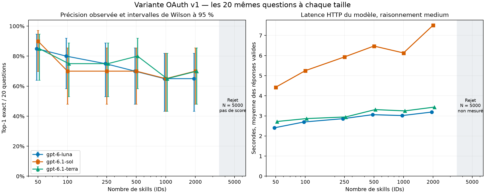

# Les trois modèles restent proches sur ce test, avec une couverture limitée à 2 000 skills

Étude de découverte de skills par listing, réalisée le 3 novembre 2026. Modèles : `gpt-6-luna`, `gpt-6.1-sol`, `gpt-6.1-terra`. Cette exécution est une **variante OAuth du protocole v1**, pas une reproduction strictement équivalente à une API avec température 0 et sortie limitée à 500 tokens.

## Ce que les résultats permettent de dire

- Les trois modèles ont produit **120 réponses valides chacun**, sur les tailles 50, 100, 250, 500, 1 000 et 2 000. Leur score top-1 exact se situe entre **72,5 % et 75,0 %** sur ces six tailles. Les différences appariées restent compatibles avec zéro sur les 20 questions disponibles.
- À 5 000 skills, chaque modèle a subi **un rejet HTTP 400 `string_above_max_length`**. Les 19 autres essais de cette taille n’ont pas été exécutés. Ce rejet de longueur de chaîne ne mesure pas une limite de contexte du modèle et ne vaut pas 0 % de précision.
- L’audit démontre un biais plus précis que la seule règle « remplacer le dernier » : **les 20 golds sont déjà aux positions 1 à 20 pour les sept tailles**. Le remplacement final ne s’est jamais déclenché. Les performances sont donc conditionnelles à une position initiale très favorable des réponses attendues.
- Les données brutes v1 sont conservées. La comparabilité avec les résultats cloud précédents reste **non vérifiée**, faute du runner original et de ses listes ordonnées. Les différences OAuth constituent de toute façon une condition expérimentale distincte.

## Couverture réelle et performances observées

| Modèle | Réponses / prévues | Top-1 exact, tailles mesurées | Latence moyenne / médiane (s) | Tokens entrée / sortie, rapportés |
| --- | --- | --- | --- | --- |
| Luna | 120/140 | 88/120 (73,3 %) | 2,872 / 2,743 | 3 444 430 / 11 830 |
| Sol 6.1 | 120/140 | 87/120 (72,5 %) | 5,952 / 5,896 | 3 444 430 / 11 812 |
| Terra 6.1 | 120/140 | 90/120 (75,0 %) | 3,088 / 2,939 | 3 444 430 / 5 194 |

Les pourcentages ci-dessus sont conditionnels aux **six tailles entièrement mesurées**, et non aux 140 lignes prévues. Les latences couvrent l’aller-retour HTTP et la génération, sans la pause d’une seconde entre requêtes. Elles dépendent aussi du réseau, du service, du cache de préfixe éventuel et de la longueur des sorties : ce ne sont pas des mesures isolées du matériel du modèle.

Les trois CSV contiennent bien **420 lignes au total, avec les 45 colonnes demandées**. Ils se décomposent en **360 réponses valides, 3 rejets et 57 lignes `NOT_RUN_AFTER_MODEL_STOP`**. Il y a eu 363 requêtes de benchmark, plus les 3 petits essais d’admission, soit 366 POST d’inférence demandés au service. Les rejets n’ont pas été retentés ; aucun quota ni rate limit n’a été observé. Aucun benchmark local GPU n’a été exécuté dans cette étude.

Les champs numériques à zéro des lignes non exécutées ne sont que des valeurs de structure du format CSV : **ils ne constituent pas des observations**. Ces lignes sont exclues des scores, intervalles et courbes ci-dessous. Aucun prix API n’a été appliqué : `est_cost_usd` reste vide. L’usage a été demandé via la connexion OAuth consentie, sans clé API classique, achat de crédits ni bascule de facturation. Le coût monétaire réel du forfait n’a pas été mesuré.

### Top-1 exact par taille

Chaque cellule mesurée porte sur les **mêmes 20 questions**, réutilisées à la taille suivante. Les intervalles sont des intervalles de Wilson à 95 % calculés avec **n = 20 par taille**.

| Taille | Luna, exact et IC 95 % | Sol 6.1, exact et IC 95 % | Terra 6.1, exact et IC 95 % |
| --- | --- | --- | --- |
| 50 | 17/20 = 85,0 % [64,0–94,8 %] | 18/20 = 90,0 % [69,9–97,2 %] | 17/20 = 85,0 % [64,0–94,8 %] |
| 100 | 16/20 = 80,0 % [58,4–91,9 %] | 14/20 = 70,0 % [48,1–85,5 %] | 15/20 = 75,0 % [53,1–88,8 %] |
| 250 | 15/20 = 75,0 % [53,1–88,8 %] | 14/20 = 70,0 % [48,1–85,5 %] | 15/20 = 75,0 % [53,1–88,8 %] |
| 500 | 14/20 = 70,0 % [48,1–85,5 %] | 14/20 = 70,0 % [48,1–85,5 %] | 16/20 = 80,0 % [58,4–91,9 %] |
| 1000 | 13/20 = 65,0 % [43,3–81,9 %] | 13/20 = 65,0 % [43,3–81,9 %] | 13/20 = 65,0 % [43,3–81,9 %] |
| 2000 | 13/20 = 65,0 % [43,3–81,9 %] | 14/20 = 70,0 % [48,1–85,5 %] | 14/20 = 70,0 % [48,1–85,5 %] |
| 5000 | Non mesuré : 1 rejet, 19 non exécutés | Non mesuré : 1 rejet, 19 non exécutés | Non mesuré : 1 rejet, 19 non exécutés |



La baisse observée entre 50 et 2 000 skills est de 20 points pour Luna et Sol, et de 15 points pour Terra. Elle décrit ce jeu de questions et ces listes ; elle ne démontre pas une loi générale de dégradation. Les golds toujours placés au début ne testent notamment pas le cas où la réponse est enfouie au milieu d’un long contexte.

### Couverture, latence et tokens par taille et modèle

Les tokens sont ceux de `response.completed.usage`, rapportés par le serveur. Les tokens de sortie incluent le raisonnement lorsqu’il est comptabilisé par le service. Les rejets ne retournent pas d’usage exploitable ; aucune estimation ne remplace ces valeurs manquantes.

| Modèle | N | Réponses valides | Rejets | Non exécutés | Latence moyenne (s) | Tokens entrée, moyenne | Tokens sortie, moyenne |
| --- | --- | --- | --- | --- | --- | --- | --- |
| Luna | 50 | 20/20 | 0 | 0 | 2,408 | 2142,75 | 90,85 |
| Luna | 100 | 20/20 | 0 | 0 | 2,697 | 4236,75 | 90,30 |
| Luna | 250 | 20/20 | 0 | 0 | 2,861 | 11034,75 | 95,90 |
| Luna | 500 | 20/20 | 0 | 0 | 3,061 | 21867,75 | 102,15 |
| Luna | 1000 | 20/20 | 0 | 0 | 3,017 | 43843,75 | 111,35 |
| Luna | 2000 | 20/20 | 0 | 0 | 3,190 | 89095,75 | 100,95 |
| Luna | 5000 | 0/20 | 1 | 19 | — | — | — |
| Sol 6.1 | 50 | 20/20 | 0 | 0 | 4,425 | 2142,75 | 67,40 |
| Sol 6.1 | 100 | 20/20 | 0 | 0 | 5,248 | 4236,75 | 83,95 |
| Sol 6.1 | 250 | 20/20 | 0 | 0 | 5,929 | 11034,75 | 109,95 |
| Sol 6.1 | 500 | 20/20 | 0 | 0 | 6,472 | 21867,75 | 117,95 |
| Sol 6.1 | 1000 | 20/20 | 0 | 0 | 6,130 | 43843,75 | 102,20 |
| Sol 6.1 | 2000 | 20/20 | 0 | 0 | 7,507 | 89095,75 | 109,15 |
| Sol 6.1 | 5000 | 0/20 | 1 | 19 | — | — | — |
| Terra 6.1 | 50 | 20/20 | 0 | 0 | 2,721 | 2142,75 | 26,90 |
| Terra 6.1 | 100 | 20/20 | 0 | 0 | 2,865 | 4236,75 | 32,70 |
| Terra 6.1 | 250 | 20/20 | 0 | 0 | 2,946 | 11034,75 | 42,75 |
| Terra 6.1 | 500 | 20/20 | 0 | 0 | 3,312 | 21867,75 | 47,80 |
| Terra 6.1 | 1000 | 20/20 | 0 | 0 | 3,248 | 43843,75 | 50,20 |
| Terra 6.1 | 2000 | 20/20 | 0 | 0 | 3,437 | 89095,75 | 59,35 |
| Terra 6.1 | 5000 | 0/20 | 1 | 19 | — | — | — |

Les 360 réponses valides totalisent **10 333 290 tokens d’entrée** et **28 836 tokens de sortie rapportés**. Les essais d’admission, séparés de ces résultats, totalisent 429 tokens d’entrée et 50 de sortie. Les totaux n’imputent aucun faux zéro d’usage aux trois rejets.

### Qualité du classement

| Modèle | N | R@1 | R@3 | R@5 | R@10 | MRR@10 | NDCG@10 |
| --- | --- | --- | --- | --- | --- | --- | --- |
| Luna | 50 | 85,0 % | 90,0 % | 95,0 % | 95,0 % | 0,8767 | 0,8943 |
| Luna | 100 | 80,0 % | 85,0 % | 85,0 % | 95,0 % | 0,8368 | 0,8624 |
| Luna | 250 | 75,0 % | 85,0 % | 85,0 % | 85,0 % | 0,7917 | 0,8065 |
| Luna | 500 | 70,0 % | 80,0 % | 80,0 % | 80,0 % | 0,7417 | 0,7565 |
| Luna | 1000 | 65,0 % | 70,0 % | 75,0 % | 85,0 % | 0,7030 | 0,7376 |
| Luna | 2000 | 65,0 % | 75,0 % | 85,0 % | 85,0 % | 0,7117 | 0,7452 |
| Sol 6.1 | 50 | 90,0 % | 95,0 % | 100,0 % | 100,0 % | 0,9267 | 0,9443 |
| Sol 6.1 | 100 | 70,0 % | 90,0 % | 95,0 % | 100,0 % | 0,8183 | 0,8633 |
| Sol 6.1 | 250 | 70,0 % | 80,0 % | 90,0 % | 90,0 % | 0,7558 | 0,7909 |
| Sol 6.1 | 500 | 70,0 % | 80,0 % | 80,0 % | 85,0 % | 0,7488 | 0,7732 |
| Sol 6.1 | 1000 | 65,0 % | 70,0 % | 75,0 % | 80,0 % | 0,6931 | 0,7181 |
| Sol 6.1 | 2000 | 70,0 % | 70,0 % | 75,0 % | 80,0 % | 0,7183 | 0,7372 |
| Terra 6.1 | 50 | 85,0 % | 95,0 % | 95,0 % | 95,0 % | 0,8833 | 0,9000 |
| Terra 6.1 | 100 | 75,0 % | 85,0 % | 90,0 % | 90,0 % | 0,8017 | 0,8259 |
| Terra 6.1 | 250 | 75,0 % | 80,0 % | 85,0 % | 95,0 % | 0,7981 | 0,8326 |
| Terra 6.1 | 500 | 80,0 % | 80,0 % | 80,0 % | 80,0 % | 0,8000 | 0,8000 |
| Terra 6.1 | 1000 | 65,0 % | 75,0 % | 80,0 % | 80,0 % | 0,7100 | 0,7324 |
| Terra 6.1 | 2000 | 70,0 % | 75,0 % | 75,0 % | 80,0 % | 0,7333 | 0,7494 |

Les métriques complètes à K = 1, 3, 5 et 10 figurent dans les CSV. Avec un seul gold, un hit à un rang r ≤ K donne R@K = 1, P@K = 1/K, NDCG@K = 1/log2(r+1), MRR@K = AP@K = 1/r. Ainsi P@10 ne peut pas dépasser 0,1 ; ce n’est pas une précision de sélection top-1 de 10 %.

| Modèle | Noms invalides dans les listes, cumul | Top-1 supplémentaire par fallback de casse |
| --- | --- | --- |
| Luna | 30 | 0 |
| Sol 6.1 | 4 | 0 |
| Terra 6.1 | 1 | 0 |

Une réponse « valide » signifie ici qu’elle a terminé sans erreur technique et contient au moins un nom reconnu. Elle peut encore contenir des noms invalides dans d’autres rangs. Les positions invalides et les répétitions sont conservées : une bonne réponse classée deuxième n’est jamais promue première après suppression d’une mauvaise entrée. Le fallback de casse est suivi séparément ; il n’a ajouté aucun succès top-1 dans ce run.

## Incertitude : 20 questions, pas 140 observations indépendantes

Les 120 réponses valides d’un modèle sont 20 questions répétées sur six tailles. Un intervalle binomial calculé comme si n = 120 ou 140 était indépendant sous-estimerait cette dépendance. Pour la moyenne globale, le bootstrap rééchantillonne **20 blocs « question »** ; chaque bloc conserve ses six tailles et les trois modèles. Les comparaisons entre modèles utilisent les mêmes indices rééchantillonnés : 10 000 réplicats, graine d’analyse 20261103, intervalles percentiles à 95 %.

| Modèle | Moyenne sur les six tailles | Intervalle bootstrap par question, 95 % |
| --- | --- | --- |
| Luna | 73,3 % | 55,0–90,0 % |
| Sol 6.1 | 72,5 % | 54,2–90,0 % |
| Terra 6.1 | 75,0 % | 56,7–90,8 % |

| Comparaison, gauche moins droite | Écart observé (points) | Intervalle apparié 95 % (points) |
| --- | --- | --- |
| Luna − Sol 6.1 | 0,83 | -2,50 à 4,17 |
| Luna − Terra 6.1 | -1,67 | -5,83 à 1,67 |
| Sol 6.1 − Terra 6.1 | -2,50 | -8,33 à 1,67 |

Tous les intervalles appariés contiennent zéro. Cela ne prouve pas l’égalité des modèles ; l’échantillon ne permet pas d’affirmer une supériorité fiable. Les intervalles de Wilson par taille supposent des cas Bernoulli distincts conditionnellement à la liste. Le bootstrap décrit la sensibilité à ces 20 cas, avec listes et paramètres observés fixés. Ni l’un ni l’autre ne couvre le biais de position, la fuite des noms, les autres graines de bibliothèques, la variabilité du décodage ou toute la population des tâches. Ils restent descriptifs, sans correction de multiplicité ni revendication confirmatoire.

## Audit du protocole et limites qui changent l’interprétation

### Le gold est toujours au début, et non forcé à la fin dans ce run

La reconstruction indépendante suit exactement l’ordre reçu, `random.Random(42).sample(all_skills, N)`, puis remplace le dernier élément seulement si le `gold_id` est absent. Pour les trois modèles, **les 140 séquences ordonnées de candidats et leurs empreintes de messages logiques correspondent aux manifestes du run**.

| N, IDs | Noms distincts | Gold remplacés en dernier | Positions des 20 golds | Caractères dans instructions |
| --- | --- | --- | --- | --- |
| 50 | 50 | 0 | 1 à 20, dans l’ordre des questions | 10 295 |
| 100 | 100 | 0 | 1 à 20, dans l’ordre des questions | 20 851 |
| 250 | 250 | 0 | 1 à 20, dans l’ordre des questions | 54 255 |
| 500 | 499 | 0 | 1 à 20, dans l’ordre des questions | 108 801 |
| 1000 | 992 | 0 | 1 à 20, dans l’ordre des questions | 217 958 |
| 2000 | 1973 | 0 | 1 à 20, dans l’ordre des questions | 438 935 |
| 5000 | 4856 | 0 | 1 à 20, dans l’ordre des questions | 1 094 067 |

Les gold IDs du fichier reçu coïncident aussi exactement, dans l’ordre des questions, avec `random.Random(42).sample(all_skills, 20)`. C’est un couplage effectif du jeu de questions et du tirage de candidats. La règle de remplacement en dernière position demeure une limite potentielle du protocole général, mais **elle n’a pas été activée ici**. L’hypothèse de tirages indépendants donnant environ 0,8 % de présence à N=50 ne décrit donc pas ce run. L’avantage positionnel observé est un biais de début de liste. Rien n’a été réordonné après découverte de ce point.

### Noms dupliqués, fuite des noms et pertinence unique

Les sources contiennent **6 006 IDs pour 5 801 noms distincts**, soit **153 groupes de noms dupliqués et 358 enregistrements concernés**. Trois des 20 golds portent un nom non unique dans la source. Aucun dédoublonnage n’a été effectué. Un modèle répondant uniquement par nom ne peut pas distinguer deux IDs portant le même nom : ces scores portent sur le **nom attendu**, pas sur une identité UUID prouvée.

Une vérification conservatrice trouve une correspondance exacte du nom normalisé dans **6 requêtes sur 20** (casse et séparateurs normalisés). Ce comptage n’exclut pas d’autres indices lexicaux dans les 14 restantes. Les requêtes guidées par le nom rendent le test en partie lexical. De plus, un seul gold est fourni alors que plusieurs skills peuvent être sémantiquement acceptables ; une alternative pertinente peut donc être comptée fausse. Aucune annotation n’a été corrigée après lecture des sorties.

### Le rejet à 5 000 est une limite d’enveloppe, pas une mesure de contexte

À N=5 000, la chaîne `instructions` reconstruite contient **1 094 067 caractères** (1 095 016 octets UTF-8). Les trois services ont renvoyé `string_above_max_length`. Les réponses assainies conservées ne donnent pas la valeur maximale exacte du champ ; elle n’est donc pas inventée ici. Le code d’erreur est un rejet de longueur de chaîne, et les indicateurs `context_limit` restent faux. Il ne permet pas de conclure que les modèles eux-mêmes ne peuvent pas traiter les tokens correspondants.

Le catalogue OAuth du compte annonçait **272 000 tokens pour Luna** et **500 000 pour Sol et Terra**, contre un maximum de 1 050 000 sur les fiches API publiques. Les limites du catalogue authentifié ont été utilisées. La barrière v1 `44,5 × N + 200 > 90 % de la fenêtre` n’a bloqué aucun essai : à 5 000, elle estimait 222 700 tokens. C’est une estimation, pas un comptage réel du prompt rejeté. Aucun dépassement de contexte en tokens n’a été mesuré.

### Différences OAuth et comparabilité cloud

La voie officielle OAuth utilise Responses en streaming, `store=false`, et le texte système dans `instructions`. Elle ne permet pas d’imposer `temperature=0` ni `max_output_tokens=500` : ces champs sont absents, sans modification silencieuse. Le raisonnement n’a pas été fixé dans la requête ; les 360 réponses terminées déclarent `medium`. Il n’y a eu ni outil agent, ni retrieval externe, ni exécution des skills. Les descriptions sont limitées à 300 caractères Unicode par le protocole.

Les modèles ont été exécutés séquentiellement, avec une pause d’une seconde hors latence par requête. Le cache de préfixe du fournisseur n’est pas contrôlé sur cette route. Les latences de sorties de longueurs différentes ne sont pas des mesures matérielles comparables à des modèles locaux GPU. Les alias de modèles n’ont pas été remplacés par des versions datées inventées ; l’identité renvoyée par le serveur a été auditée pendant le run.

Les deux fichiers reçus et le sampling littéral sont vérifiés, mais le runner et les candidats ordonnés du run cloud de référence n’ont pas été fournis. Il faut vérifier la portée de son RNG, les chaînes effectives, le tokenizer, les paramètres et les dénominateurs avant toute fusion de courbes. La formule de précision de sélection est TP / requêtes valides ; le rappel de sélection sur tous les cas est TP / 20 à une taille entièrement exécutée. Le rappel n’est pas simplement le taux de réponses : une réponse fausse n’est pas un TP. La disponibilité est une mesure séparée.

## Validation et reproduction

- Schéma exact de 45 colonnes, unicité de 140 couples taille/question par modèle et golds concordants.
- Correspondance champ par champ entre CSV et snapshot transactionnel SQLite des 363 essais enregistrés.
- Recalcul indépendant de toutes les métriques à K, des sommes de tokens et des dénominateurs ; latences finies et non négatives ; coûts inconnus laissés vides.
- Vérification indépendante des séquences de candidats et hashes des 140 messages logiques pour chacun des trois modèles.
- **28 tests synthétiques réussis**, sans nouvelle inférence. Un test a mis en évidence un verrou de fichier Windows transitoire ; le runner partageable ajoute un retry borné du remplacement atomique du fichier, jamais du POST modèle. Le code exact mesuré reste archivé séparément.

Les classements/rangs exportés sont conservés, ainsi que les hashes des réponses. Le texte HTTP intégral des réponses n’a pas été sauvegardé ; on ne peut donc pas réauditer indépendamment chaque normalisation de format ou de suffixe à partir du texte brut. Le contrôle arithmétique ne doit pas être présenté comme une validation sémantique des golds.

Le paquet fournit une dérivée minimale des données : ID, nom et les 300 premiers caractères de description, dans l’ordre original. **Les 140 prompts logiques restent identiques**, ce qui est vérifié contre les manifestes. Le fichier complet original de 117,6 Mo, avec corps de skills inutilisés, n’est pas redistribué. Les deux hashes d’origine et le hash de la dérivée figurent dans [la provenance des données](data/PROVENANCE.json). Le runner de reproduction accepte explicitement le hash de cette dérivée ; le code exact utilisé pour les mesures reste dans `source-original/`. Cette adaptation de packaging et le retry de fichiers ne sont pas une correction du sampling v1 et ne changent aucun résultat mesuré.

Pour reproduire les calculs et les figures sans appeler de modèle :

```powershell
python -m venv .venv
.\.venv\Scripts\python.exe -m pip install -r requirements-oauth.txt -r requirements-analysis.txt
.\.venv\Scripts\python.exe analyze_public.py
```

Pour refaire des mesures, installer séparément les dépendances OAuth, connecter son propre compte et exécuter l’admission avant la suite, comme décrit dans [README.md](README.md). Cela consomme l’usage de ce compte et peut produire d’autres réponses ; aucun nouveau run n’a été lancé pour ce rapport. Aucun fichier d’accès, état OAuth, identifiant d’installation, lien de review, jeton DPAPI ou journal sensible ne fait partie du paquet.

## Corrections proposées pour une v2 distincte

1. **Séparer les flux aléatoires** de sélection des questions, des candidats et de leur ordre. Après inclusion du gold, mélanger systématiquement la liste, même si le gold était déjà présent. Contrôler et, si souhaité, équilibrer les positions début/milieu/fin. Enregistrer plusieurs graines et la position exacte du gold.
2. **Écrire davantage de tâches indépendantes sans nom de skill**, avec diversité de domaines et revue à l’aveugle. Partir d’un jeu pilote d’au moins 100 cas, puis dimensionner l’échantillon selon la précision statistique recherchée ; ce nombre n’est pas une garantie de puissance.
3. **Annoter plusieurs réponses pertinentes lorsque nécessaire** et utiliser des IDs non ambigus. Adapter explicitement les métriques IR à plusieurs golds. Garder séparés le respect du format, la validité des noms, la disponibilité et la qualité sémantique.
4. **Traiter la limite de transport avant les grands runs** : mesurer caractères/octets/tokens et tester un format d’entrée officiellement accepté. Une modification de découpage ou de rôle des messages doit être nommée, validée et comparée dans un bras distinct ; aucune entrée refusée n’a été fractionnée ou retentée dans v1.
5. **Séparer les conditions OAuth et API/locales**. Consigner les contrôles effectivement supportés et le raisonnement observé ; répéter le décodage pour estimer sa variabilité. Ne pas supposer que tous les modèles acceptent température, seed ou plafond de sortie.
6. **Préenregistrer l’analyse et conserver les éléments d’audit utiles** : texte des sorties si le cadre de partage le permet, paramètres effectifs, traces d’erreurs assainies, ordre/positions, usages et cache lorsqu’ils sont fournis. Rapporter les comparaisons appariées par question et distinguer l’incertitude d’échantillonnage des biais systématiques.

Ces propositions n’ont pas été appliquées rétroactivement. Les trois jeux de résultats v1 restent intacts ; un nouveau protocole demanderait une nouvelle exécution séparée.

## Sources et fichiers d’appui

- Données fournies : `test.jsonl` et `test_queries.json`, hashes SHA-256 d’origine dans [PROVENANCE.json](data/PROVENANCE.json).
- [Résultats Luna](results/gpt-6-luna/details.csv), [Sol](results/gpt-6.1-sol/details.csv), [Terra](results/gpt-6.1-terra/details.csv), [analyse reproductible](results/analysis.json), [avertissement méthodologique](results/METHODOLOGY_WARNING.json).
- [OpenAI — usage du forfait OAuth et inférence](https://developers.openai.com/siwc/token-sharing-open-source/models-and-inference).
- [OpenAI — limitations de la route OAuth](https://developers.openai.com/siwc/token-sharing-open-source/preview-limitations).
- [Fiche API Luna](https://developers.openai.com/api/docs/models/gpt-6-luna), [Sol 6.1](https://developers.openai.com/api/docs/models/gpt-6.1-sol), [Terra 6.1](https://developers.openai.com/api/docs/models/gpt-6.1-terra). Les valeurs de catalogue OAuth observées sont conservées séparément, sans identité de compte.

### Admission, hors scores de benchmark

| Modèle | Résultat | Durée (s) | Tokens entrée / sortie |
| --- | --- | --- | --- |
| Luna | Admis, réponse exacte | 2,154 | 143 / 32 |
| Sol 6.1 | Admis, réponse exacte | 2,010 | 143 / 9 |
| Terra 6.1 | Admis, réponse exacte | 2,038 | 143 / 9 |
