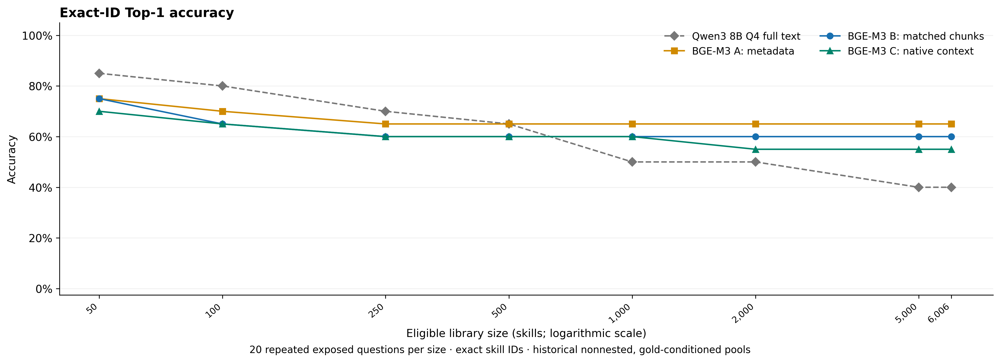
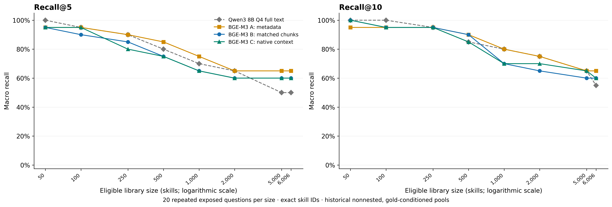
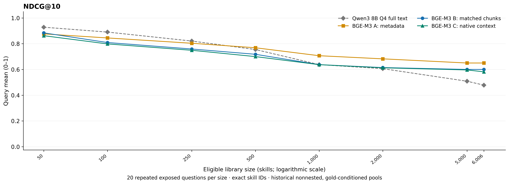
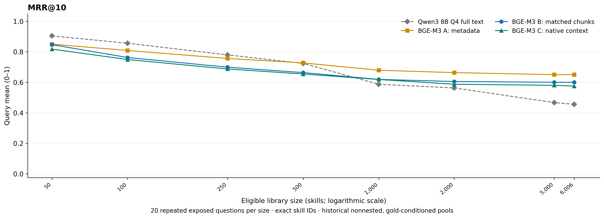
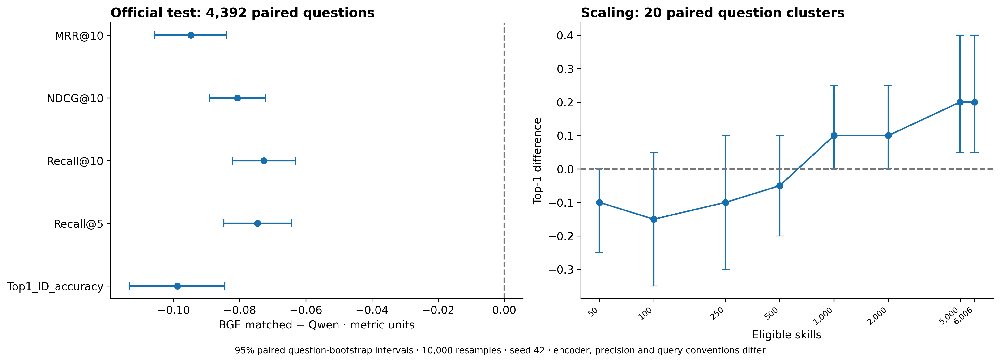
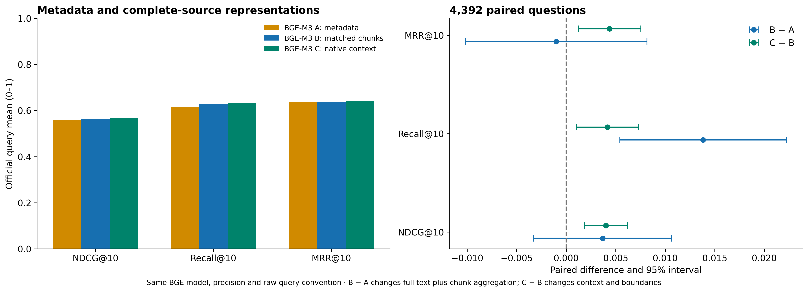
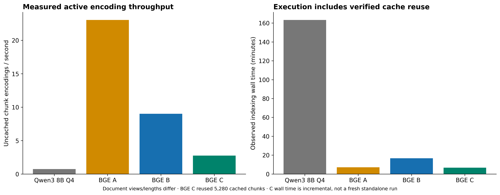
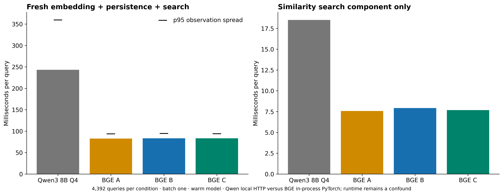
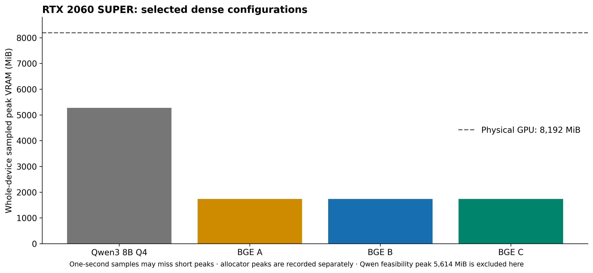

# BGE-M3 dense SkillRet benchmark against Qwen3 8B

Execution: **completed** — three configurations, 480 scaling cases and 13,176 official query/configuration cases.

All runs use the pinned 6,006 skills, 4,392 official questions and 7,187 positive judgments from the immutable Qwen study. No model weights or raw restricted text are published. Sparse, hybrid and ColBERT experiments remain unattempted.

## Official full-catalog results

| Model / configuration | Hit@1 | NDCG@10 | Recall@10 | MRR@10 | Median query latency |
|---|---:|---:|---:|---:|---:|
| Qwen3 8B Q4_K_M full text | 0.6580 | 0.642091 | 0.701389 | 0.732295 | 243.14 ms |
| A_metadata | 0.5717 | 0.557723 | 0.614906 | 0.638544 | 82.71 ms |
| B_matched | 0.5592 | 0.561399 | 0.628719 | 0.637555 | 83.36 ms |
| C_native8k | 0.5642 | 0.565406 | 0.632893 | 0.641933 | 83.38 ms |
| SkillRet Embedding 0.6B full text | Not recorded | 0.810990 | 0.876442 | 0.856349 | Not recorded at matched boundary |

Qwen values are unchanged archived measurements. SkillRet 0.6B is contextual: it strips fields, uses a 32K cap and records two truncated documents. No missing historical latency is invented.

## Scaling accuracy

Twenty exposed single-positive questions repeat at each size. All conditions retain the exact published pool IDs/order. The seven smaller libraries are not fully nested and place golds at positions 1–20; the 6,006-skill condition preserves Qwen’s seeded full-catalog order. Rankings use source text and cosine scores, with full-source SHA-256 only for exact ties.

| Skills | Qwen Top-1 | BGE A | BGE B | BGE C | A − Qwen | B − Qwen | C − Qwen |
|---:|---:|---:|---:|---:|---:|---:|---:|
| 50 | 85% | 75% | 75% | 70% | -10.0 pp | -10.0 pp | -15.0 pp |
| 100 | 80% | 70% | 65% | 65% | -10.0 pp | -15.0 pp | -15.0 pp |
| 250 | 70% | 65% | 60% | 60% | -5.0 pp | -10.0 pp | -10.0 pp |
| 500 | 65% | 65% | 60% | 60% | +0.0 pp | -5.0 pp | -5.0 pp |
| 1,000 | 50% | 65% | 60% | 60% | +15.0 pp | +10.0 pp | +10.0 pp |
| 2,000 | 50% | 65% | 60% | 55% | +15.0 pp | +10.0 pp | +5.0 pp |
| 5,000 | 40% | 65% | 60% | 55% | +25.0 pp | +20.0 pp | +15.0 pp |
| 6,006 | 40% | 65% | 60% | 55% | +25.0 pp | +20.0 pp | +15.0 pp |

## Model, exact inputs and complete coverage

The official BAAI/bge-m3 revision `5617a9f61b028005a4858fdac845db406aefb181` runs in FP16 on the local Ubuntu RTX 2060 SUPER 8 GB. The loader uses reduced CPU memory, CUDA-only parameters, official FlagEmbedding CLS pooling/normalization, and a final float32 L2 normalization. Dense vectors have 1,024 dimensions. Batch size is one; no automatic CPU fallback or batch retries are permitted.

The tested input capacity is **8,192 tokens**, including two CLS/SEP slots. Explicit full-input tokenization disables truncation and checks every model input ID against the pinned audit tokenizer. Context feasibility was tested conservatively at 512/1,024/2,048/4,096/6,144/8,192, stopping on the first OOM. Model loading took 2.794 seconds; OS file caches were not evicted.

FlagEmbedding 1.3.5’s convenience encode method enables truncation and has automatic batch retries. This study instantiates BGEM3FlagModel but calls its official dense forward directly on verified complete inputs. The unchanged backbone/CLS/normalization run with Transformers SDPA and PyTorch memory-efficient attention; math/flash/cuDNN attention fallback is disabled. CPU threads are two, OpenBLAS one, and Torch deterministic mode is enabled.

A embeds `name + " | " + description` only. B embeds the exact Qwen source-character slices of `name + " | " + description + " | " + skill_md`. C retains the same full original text with deterministic BGE-token-aware Markdown chunks and 128-token overlap. Source whitespace is never stripped.

All 6,913 Qwen chunks fit unchanged; the largest has 6,048 BGE content tokens. Required subdivisions: 0. The longest official query has 984 tokens including specials. BGE receives the original query without Qwen’s instruction prefix, following its documented convention.

| Configuration | Skills | Logical chunks | Chunked skills | Audited content tokens with overlap | Source coverage |
|---|---:|---:|---:|---:|---:|
| A_metadata | 6,006 | 6,006 | 0 | 362,754 | 100% of its defined view |
| B_matched | 6,006 | 6,913 | 726 | 16,196,723 | 100% of its defined view |
| C_native8k | 6,006 | 6,258 | 218 | 16,087,489 | 100% of its defined view |

Metadata deliberately excludes skill bodies; B and C cover every original full-text character. Max chunk cosine produces one score per skill, and top-50 rankings deduplicate by exact ID. Duplicate names remain distinct IDs. Candidate position, skill IDs and relevance labels never enter embeddings or similarity scores.

## Paired uncertainty and interpretation

The prespecified primary contrast is B matched chunks minus archived Qwen, using official NDCG@10. Every full-test difference pairs the same query ID; 10,000 question bootstrap resamples use seed 42. Scaling resamples 20 question clusters and retains their eight repeated sizes. It never treats 160 outcomes as independent questions. Secondary metrics and A/C/ablation contrasts are exploratory without multiplicity correction.

| Official B − Qwen metric | Mean difference | 95% paired interval |
|---|---:|---|
| Top1_ID_accuracy | -0.098816 | [-0.113388, -0.084472] |
| Recall@5 | -0.074643 | [-0.084737, -0.064435] |
| Recall@10 | -0.072670 | [-0.082157, -0.063145] |
| NDCG@10 | -0.080692 | [-0.089143, -0.072258] |
| MRR@10 | -0.094740 | [-0.105638, -0.083881] |

Exact B source spans, queries, candidates, qrels and metric formulas match Qwen. Remaining differences include encoder training/architecture, tokenizer, FP16 versus Q4_K_M, CLS versus the Qwen embedding pathway, 1,024 versus 4,096 dimensions, query instruction and PyTorch in-process versus Ollama HTTP runtime. Paired score differences describe these measured protocols; they do not isolate model architecture or demonstrate blinded generalization.

Within BGE, B − A measures the combined complete-source representation and max-chunk retrieval policy. C − B additionally changes context and chunk boundaries. Longer skills have more max-score opportunities. Exposed synthetic questions, incomplete judgments and gold-conditioned scaling pools limit generalization; bootstrap intervals do not remove those biases.

## Computational cost and latency

| Configuration | Actual index wall | New encoded chunks | Reused cached chunks | Peak sampled VRAM | Median / p95 full query |
|---|---:|---:|---:|---:|---:|
| A_metadata | 7.13 min | 6,006 | 0 | 1734 MiB | 82.71 / 93.66 ms |
| B_matched | 16.75 min | 6,913 | 0 | 1734 MiB | 83.36 / 94.57 ms |
| C_native8k | 6.68 min | 978 | 5,280 | 1734 MiB | 83.38 / 94.09 ms |

Across the successful monitored phases, whole-host used RAM peaked at 2.617 GiB, minimum available RAM was 4.265 GiB, and GPU temperature peaked at 67 °C. Whole-host swap-in/out deltas were 5.746/0.445 MiB. These host-wide counters are not process-private allocations. The failed initial loader is excluded and reported separately below.

| Configuration | New document encoding | Chunks / active second | Input tokens / active second | Mean sampled GPU use |
|---|---:|---:|---:|---:|
| A_metadata | 260.62 s | 23.04 | 1438 | 10.4% |
| B_matched | 767.58 s | 9.01 | 21119 | 51.2% |
| C_native8k | 354.57 s | 2.76 | 15861 | 45.5% |

Fresh query totals include encoding, full-input validation, vector-cache persistence and CPU similarity search, ending before ranking-file persistence, as in the Qwen receipt boundary. Every configuration makes fresh query measurements; cached search is separately timed and is never substituted for end-to-end query latency. Model startup and corpus indexing remain separate.

Identical text vectors are shared between B and C. C’s observed index wall therefore measures incremental work with verified cache reuse, not a fresh standalone index. The performance JSON separately records new encoding time, measured tokens/second and the logical sum of original measured per-vector receipts; the latter is a derived sum, not an observed standalone wall run. Short metadata and long full-text chunk throughputs are different workloads. Token throughput is tokenizer-specific, so BGE and Qwen tokens/second are not model-neutral units.

One-second telemetry records whole-host RAM/swap and GPU memory/utilization/temperature. CUDA allocator peaks capture shorter model allocations separately. Guards retain at least 1 GiB available RAM and 1 GiB device headroom, stop above 80 °C or 64 MiB additional host swap traffic, and never stop another workload. Electricity spend is unmeasured; no paid inference service is used.

## Contextual BGE references

The repository’s preserved official SkillRet README reports BGE-small NDCG@10 0.5451 / Recall@10 0.6001 and BGE-large 0.5900 / 0.6437 on the stated 4,392-query, 6,006-skill test. These are published contextual references, not new local measurements or matched complete-source controls. Source paths and checksums are in contextual_bge_references.json.

## Validation, vectors and reproducibility

Independent arithmetic re-scores all saved rankings, including multi-positive AP/NDCG/completeness and macro/micro candidate coverage. The official denominator remains 4,392 questions and 7,187 positive pairs; scaling keeps one positive ID per question. Official Top-1 means the first ID is any positive; completeness means every positive is recovered within K. NDCG uses linear positive gains, AP divides by all positives, precision divides by K and reciprocal rank uses the first positive. Missing questions receive zero and remain in the denominator. Full metric tables, per-query outcomes and performance components are retained as JSON and CSV.

Lossless normalized float32 vectors for all A/B/C documents and shared official/scaling queries are published through Git LFS with IDs, chunk ownership and public qrels. The snapshot replay checks every ranking and metric without a GPU, model, network call or original vector cache. See vectors/README.md and results/published_vector_replay.json. Model checkpoints, credentials, personal paths and raw source text stay outside Git.

The verified archive is 83,421,213 bytes. Replay completed all 480 scaling and 13,176 official query/configuration outcomes in 78.138 seconds with zero model/API/network requests.

## Findings

The matched-chunk B − Qwen NDCG@10 difference is -0.080692, with a 95% paired interval [-0.089143, -0.072258] below zero. This is evidence about the tested exposed protocols, with the encoder and runtime differences stated above.

B_matched-minus-A_metadata: NDCG@10 difference +0.003676, exploratory 95% paired interval [-0.003264, +0.010635].

C_native8k-minus-B_matched: NDCG@10 difference +0.004007, exploratory 95% paired interval [+0.001874, +0.006163].

The official test favors archived Qwen for Top-1, relevant-skill coverage and ranking quality. The 20-question panel reverses that ordering at the larger catalog sizes: at 6,006 skills, A/B/C Top-1 is 65%/60%/55%, versus Qwen 40%. These are different exposed question panels; the small-panel result does not overturn the 4,392-question result. No monotonic library-size improvement is established.

Full text increases Recall@10 over metadata, but B-minus-A NDCG@10 has no clear gain and Hit@1 falls. Native 8K adds a small exploratory NDCG@10 gain over matched chunks while changing boundaries as well as context. All BGE views have lower observed query latency and sampled VRAM than archived Qwen; B indexing takes 16.75 minutes versus Qwen 163.31 minutes. This is a measured runtime/workload comparison, not an isolated architecture effect or an electricity-cost estimate.

## Failed setup attempts and unattempted work

The first PyTorch dependency download exhausted the small temporary-filesystem quota before model inference. A task-specific disk-backed TMPDIR completed installation. The first model-loading feasibility invocation reached CUDA but the host swap guard stopped it before any encoding; the retained telemetry shows 894.4 MiB extra swap-out. Cgroup limits were unrestricted. Loading the backbone directly to CUDA through the official device_map argument then passed all context tests with zero additional swap-out. These setup/loading failures produced no retrieval scores and remain separate from the completed benchmark.

Sparse lexical, BM25/dense RRF, dense/sparse fusion and ColBERT reranking were not attempted. They are not reported as zero scores. Any additional interrupted execution receipts are retained separately and do not replace completed measurements.

Primary references: [BGE-M3 model card](https://huggingface.co/BAAI/bge-m3), [official FlagEmbedding](https://github.com/FlagOpen/FlagEmbedding), [pinned Qwen study](../skillret-qwen3-embedding-8b-q4km-fulltext/REPORT.md).
