# BGE-M3 LoRA: exact paired SkillRet evaluation

**Completed:** real CUDA LoRA training and all three paired A/B/C evaluations, 480 scaling cases and 13,176 official query/configuration cases. The completed baseline is preserved and reused; no official base inference was rerun.

The validation-selected adapter **decreased official matched-full-text NDCG@10**: 0.433377 versus frozen 0.561399, a difference of -12.802 percentage points (95% paired interval [-13.747, -11.856]). Training-derived short-passage validation rose from 0.802766 to 0.870773; that proxy result must not be substituted for official test performance. Checkpoint selection was fixed before every test result.

## Training and checkpoint selection

Execution used the local Ubuntu RTX 2060 SUPER 8 GB server (Intel i3-3225, approximately 7.2 GiB usable host RAM). Rank-8 LoRA with alpha 16 and dropout 0.05 targets all 48 encoder attention query/value projections. Exactly 786,432 adapter parameters train; all 567,754,752 base parameters remain frozen. The base uses FP16; PEFT adapters and AdamW moments remain FP32 for stability. CLS embeddings are normalized for the cosine InfoNCE objective, temperature 0.05.

Physical groups contain one query, one positive passage and one negative. Sixteen-group accumulation adds no extra in-batch negatives. Query/passage caps are 256/384 tokens, gradient checkpointing is nonreentrant, and the selected recipe uses AdamW peak learning rate 1e-05, 20-step warmup, linear decay, weight decay 0.01 and clipping 1.0. Encoder dropout remains enabled during training; all dropout is disabled for validation/inference.

The 64-update / 32-query smoke test passed and its updates were discarded. Main training completed **1,100 optimizer steps** and **17,600 query groups** in **80.45 minutes**, or 0.3437 eligible-query passes. Stop reason: `validation_early_stopping`. The 200-step pilot's continuation gate was passed. The maximum was two query passes; this is not a claim that every positive pair was sampled twice.

The selected trained adapter is optimizer step **950**, validation NDCG@10 **0.870773**, against frozen **0.802766**. Selection uses 128 fixed training-derived heldout queries and all 1,014 heldout skills, each represented by its first bounded passage. This short-passage proxy differs from complete test B/C. Ties select the earliest trained checkpoint. Official test queries/qrels/scores never train, mine negatives or select checkpoints.

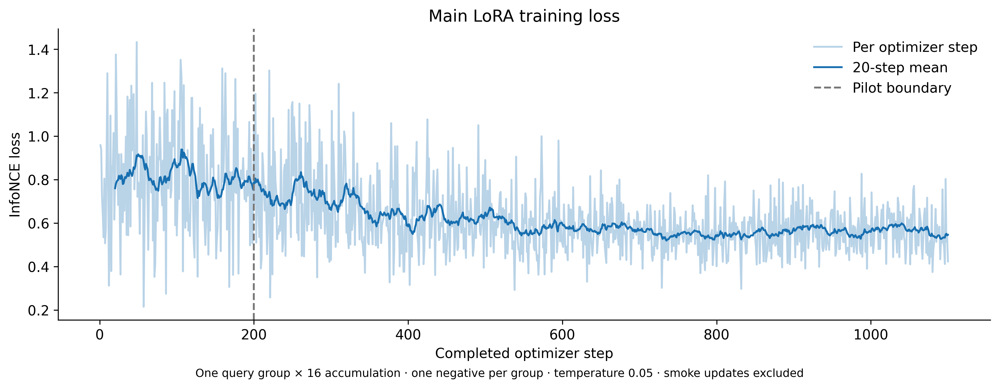

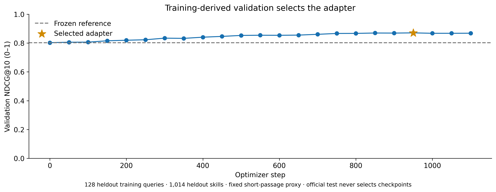

## Data and overlap

The pinned raw training split contains 10,123 skills, 63,259 queries and 127,190 qrels. Hash-grouping entire skill identities and excluding cross-group multi-positive queries leaves **51,208 training queries / 9,109 skills**. Validation holds out 1,014 skills; 128 queries are used and 2,185 remain heldout/unused. There are no shared skill IDs, source URLs, normalized bodies or namespace identities with test. Exact normalized query overlap with test and across train/validation is zero; the fixed TF-IDF lexical-cosine audit at 0.95 also finds none. This proxy does not guarantee absence of semantic near-duplicates.

The raw training split contains 435 repeated normalized query texts, all with identical positive sets. Eligible training retains 50,859 unique normalized texts; these repeated examples are retained and explicitly counted. Every training query's positive IDs independently match its qrels. The selected validation questions and all official test question texts are unique after normalization.

Positives come only from actual training qrels. The selected recipe uses the same first explicit source passage for positive and negative skills, containing metadata and the beginning of the body. A skill-level label does not establish that every chunk is positive. Supervised updates and mining candidates use only the training partition. Hard negatives come from frozen BGE-M3 over training skills; deterministic random negatives alternate. Every known positive is filtered. All example IDs, negative IDs, source hashes and passage spans are published without raw training text.

## Official full-catalog results

| Model / view | Hit@1 | NDCG@10 | Recall@10 | MRR@10 | Median fresh query |
|---|---:|---:|---:|---:|---:|
| BGE-M3 Base A_metadata | 0.571721 | 0.557723 | 0.614906 | 0.638544 | 82.71 ms |
| BGE-M3 LoRA A_metadata | 0.370674 | 0.382641 | 0.436703 | 0.433999 | 93.34 ms |
| BGE-M3 Base B_matched | 0.559199 | 0.561399 | 0.628719 | 0.637555 | 83.36 ms |
| BGE-M3 LoRA B_matched | 0.395719 | 0.433377 | 0.518708 | 0.480229 | 93.92 ms |
| BGE-M3 Base C_native8k | 0.564208 | 0.565406 | 0.632893 | 0.641933 | 83.38 ms |
| BGE-M3 LoRA C_native8k | 0.388889 | 0.428759 | 0.514762 | 0.472821 | 94.06 ms |
| Qwen3 8B Q4_K_M full text | 0.658015 | 0.642091 | 0.701389 | 0.732295 | 243.14 ms |
| SkillRet Embedding 0.6B full text | Not recorded | 0.810990 | 0.876442 | 0.856349 | Not recorded at matched boundary |

All 4,392 official questions, 6,006 skills and 7,187 binary relevance pairs remain in every view. No missing query is dropped. Exact skill IDs distinguish duplicate names. Recall@20 equals macro candidate Coverage@20 in the saved ranking convention; macro/micro candidate coverage is also independently checked. Full Recall@1/5/10/20, NDCG@5/10, MRR@5/10, MAP@5/10, Precision@5/10, completeness and candidate @20/50 results are in JSON/CSV.

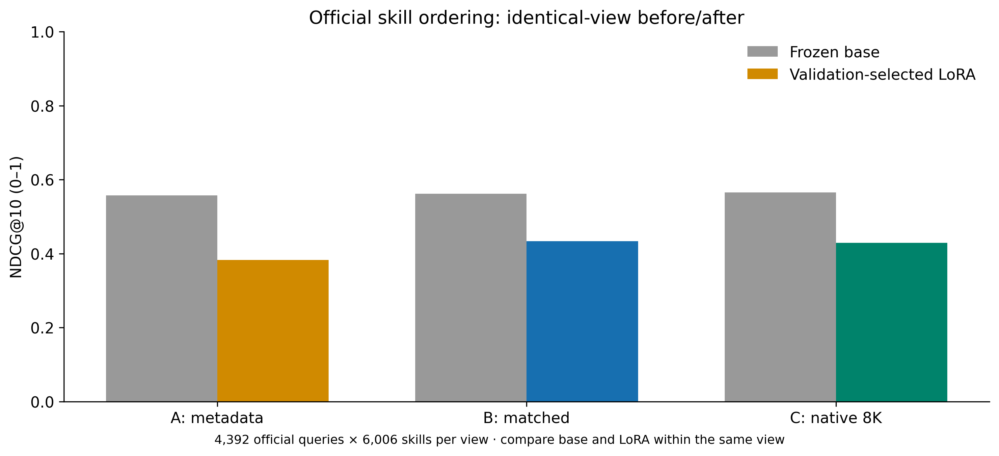

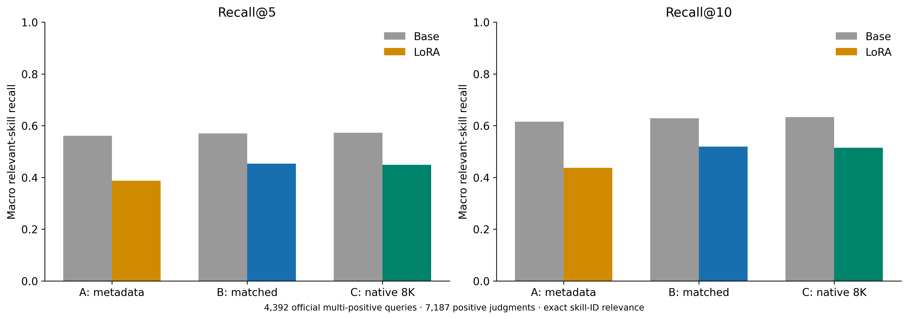

## Paired training effect and uncertainty

The primary contrast is **LoRA B matched minus Base B matched official NDCG@10**. Identical question IDs, source character spans, candidates, complete input tokens, precision of frozen weights, CLS pooling, float32 storage, maximum-chunk aggregation and source-hash tie-breaking isolate the adapter change. Zero-adapter PEFT parity passed against previously saved baseline vectors at absolute tolerance 3e-5 and cosine at least 0.999998. All frozen tensors hash identically before and after training.

Intervals use 10,000 paired question bootstrap resamples with seed 42. Scaling retains the 20 repeated questions as linked clusters across eight sizes. All other view/metric contrasts are exploratory without multiplicity adjustment. Relative changes use the matching base mean. Intervals condition on this single seed and selected adapter; they do not measure training-seed or checkpoint-selection uncertainty. A positive interval supports an increase under this measured exposed protocol, not architecture-level causation or blinded deployment performance.

| View | NDCG@10 difference (pp) | 95% paired interval (pp) | Improved / degraded / unchanged queries |
|---|---:|---|---|
| A: metadata | -17.508 | [-18.464, -16.548] | 413 / 1,932 / 2,047 |
| B: matched | -12.802 | [-13.747, -11.856] | 617 / 1,845 / 1,930 |
| C: native 8K | -13.665 | [-14.634, -12.700] | 619 / 1,880 / 1,893 |

Absolute/relative changes, paired intervals and improved/degraded/unchanged counts for every required metric are in `paired_base_vs_lora.csv`; full per-query deltas are preserved.

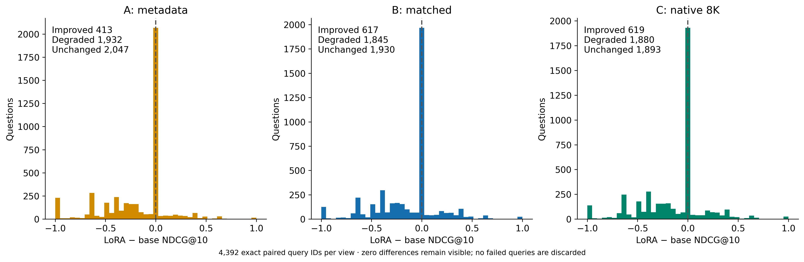

## Scaling and representation

| Skills | A base → LoRA | A change | B base → LoRA | B change | C base → LoRA | C change |
|---:|---:|---:|---:|---:|---:|---:|
| 50 | 75% → 75% | +0 pp | 75% → 70% | -5 pp | 70% → 70% | +0 pp |
| 100 | 70% → 75% | +5 pp | 65% → 60% | -5 pp | 65% → 60% | -5 pp |
| 250 | 65% → 60% | -5 pp | 60% → 50% | -10 pp | 60% → 50% | -10 pp |
| 500 | 65% → 60% | -5 pp | 60% → 40% | -20 pp | 60% → 40% | -20 pp |
| 1,000 | 65% → 60% | -5 pp | 60% → 35% | -25 pp | 60% → 40% | -20 pp |
| 2,000 | 65% → 60% | -5 pp | 60% → 35% | -25 pp | 55% → 40% | -15 pp |
| 5,000 | 65% → 45% | -20 pp | 60% → 25% | -35 pp | 55% → 25% | -30 pp |
| 6,006 | 65% → 45% | -20 pp | 60% → 25% | -35 pp | 55% → 25% | -30 pp |

These are twenty repeated exposed single-positive questions. Pools exactly preserve baseline ID/order, nonnested membership and the smaller-pool gold-position bias. The 6,006 condition keeps the original seeded full order. They do not replace the larger multi-positive official evaluation.

A is exactly name + separator + description; B and C retain every full-source character. B uses all 6,913 original Qwen slices; C uses the baseline’s 6,258 native 8K slices, including 128-token overlap. No adapter inference silently truncates, re-chunks or reuses frozen vectors.

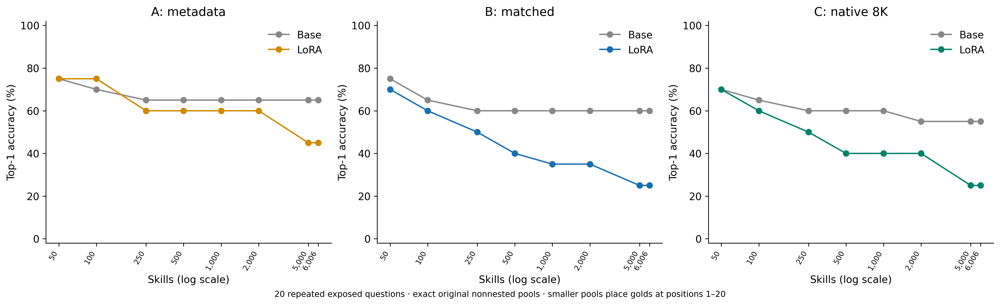

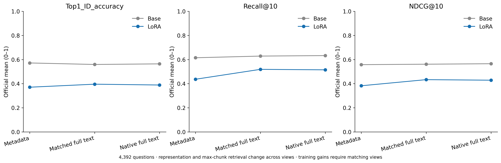

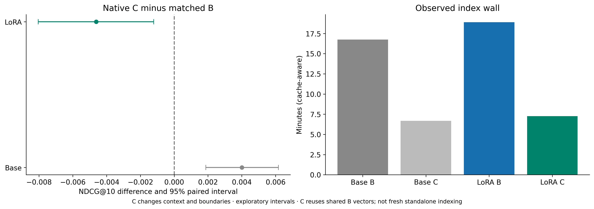

| Model | Within-model contrast | NDCG@10 difference (pp) | Exploratory 95% paired interval (pp) |
|---|---|---:|---|
| Base | B_matched − A_metadata | +0.368 | [-0.326, +1.063] |
| Base | C_native8k − B_matched | +0.401 | [+0.187, +0.616] |
| LoRA | B_matched − A_metadata | +5.074 | [+3.945, +6.203] |
| LoRA | C_native8k − B_matched | -0.462 | [-0.804, -0.121] |

## Measured cost and hardware

Main training throughput is 0.2279 optimizer steps/s and 3.646 groups/s. Active optimizer-group throughput is 3010 input tokens/s, excluding validation/mining; total main-wall throughput is 2802 tokens/s. The selected adapter is 3,158,808 bytes. Base backbone loading took 3.875 seconds after input hash checks; OS file cache was not evicted.

During main training, sampled whole-device VRAM peaked at 1782 MiB, CUDA allocated/reserved peaks were 1273.1/1596.0 MiB, whole-host used RAM peaked at 3.349 GiB and minimum available RAM was 3.533 GiB. GPU temperature peaked at 65 °C, mean sampled GPU use was 55.6%, and host swap-in/out deltas were 0.000/0.000 MiB. One-second samples can miss brief peaks; host-wide counters are not process-private measurements.

| View | Base index wall | LoRA index wall | LoRA new / cached chunks | LoRA median / p95 fresh query |
|---|---:|---:|---:|---:|
| A: metadata | 7.13 min | 7.91 min | 6,006 / 0 | 93.34 / 104.48 ms |
| B: matched | 16.75 min | 18.91 min | 6,913 / 0 | 93.92 / 105.17 ms |
| C: native 8K | 6.68 min | 7.26 min | 978 / 5,280 | 94.06 / 105.53 ms |

C index wall is incremental shared-cache work in each model, not a fresh standalone index. Every adapter document/query vector is recomputed for the selected adapter. Fresh query totals include embedding, complete-input validation, atomic vector-cache persistence and CPU search, ending before ranking persistence, as in the base study. Cached-vector search is reported separately in `query_component_comparison.csv`. Electricity is unmeasured and no paid/cloud inference was used.

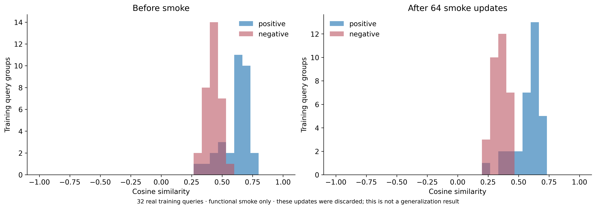

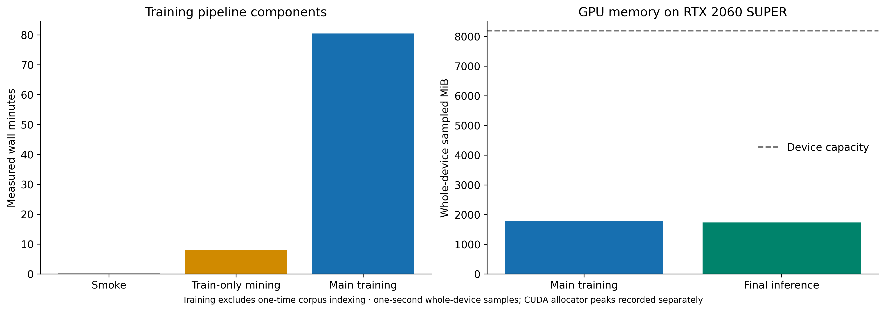

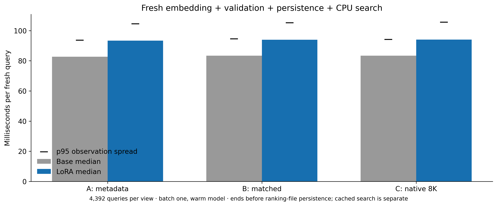

## Historical context and limitations

Archived Qwen3 8B Q4_K_M remains NDCG@10 0.642091 / Recall@10 0.701389 / MRR@10 0.732295; SkillRet 0.6B remains 0.810990 / 0.876442 / 0.856349. Qwen uses 4,096 dimensions, Q4 quantization, a 4K context and a query instruction through Ollama HTTP. BGE uses 1,024 dimensions, an FP16 base and raw queries through PyTorch. SkillRet 0.6B has specialized training, FP16 weights, last-token pooling, a query instruction, stripped source fields, source-order ties, a 32K cap and two truncated documents. These historical comparisons do not isolate architecture or parameter count. Its saved historical retrieval median is 69.77 ms, but its persistence boundary, CPU-thread setting and runtime differ; the matched-boundary table entry remains missing. Exact historical pins and source hash are in `historical_skillret_protocol.json`.

The paired base/LoRA comparison is the primary evidence. Public synthetic questions, incomplete qrels, possible unknown semantic overlap, limited training-derived validation, short training passages versus full 8K inference and adaptive checkpoint selection constrain generalization. Known-positive filtering cannot remove unjudged positives. Repeated training texts receive repeated weight. The small scaling panel has known gold-conditioned membership and position bias. No downloaded skill code was executed.

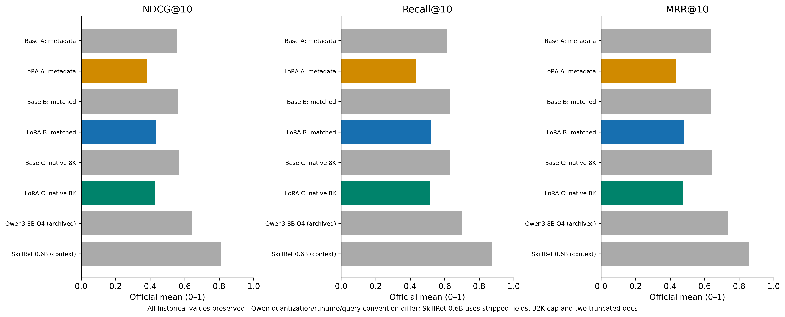

## Integrity, failures and reuse

All input hashes, exact candidate/source manifests, normalized 1,024-dimensional vectors and independent saved-ranking metrics passed. Main training recorded 0 gradient-overflow attempts. Separate setup/amendment receipts retain any interrupted preprocessing and metadata corrections without replacing measurements.

Best/final adapters and optimizer/scheduler/scaler/random-generator recovery states were saved outside Git. Portable best/final adapter weights are published separately from the base model; no base checkpoint, raw source corpus, credential or personal path belongs in the repository. The lossless vector archive contains all adapted A/B/C documents and shared official/scaling queries. Its replay verifies every ranking and metric without a model, GPU, network request or original cache. Sparse/hybrid/ColBERT extensions were unattempted. All baseline evidence remains unchanged.

The first recipe used lexical best-chunk positives, lead-only negatives and a 1e-4 learning rate. Its 200-update pilot took 14.27 minutes and failed the validation gate: best NDCG@10 0.418016 versus frozen 0.802766. It received no full continuation or official test evaluation. Its receipts, exact executed sources and passage-selection manifest are archived under `results/attempts/01-lexical-positive-pilot/`.

A training-only diagnostic found 62.43% of lexical positives were noninitial passages while every negative was a lead passage, creating a possible label/style confound. Recovery changed both passage policy and learning rate before any official scores were inspected. Their separate contributions are not identified. Frozen mining IDs and the identical frozen validation reference were reused. The main selected-trajectory time above excludes the discarded pilot; both measured costs remain explicit.

Explicit training-view audit: 31 of 51,208 queries omit trailing source beyond the selected window. Mean selected query content is 111.58 tokens. Of 99,294 eligible positive pairs, 93,628 selected passages are shorter than the complete skill; mean selected positive content is 324.76 tokens. These are declared training passages, not complete-source inference coverage claims.

Portable adapter save/load check: **passed**. Reloaded step 950 reproduces 128/128 original heldout validation top-50 rankings and the recorded metrics. This uses training-derived validation only and never changes checkpoint selection or official results.

The adapted archive is 83,392,201 bytes, SHA-256 `27f1463f1bce2f7d2f213decf0dc038e1a61f2922b1f4b8a321f46a7fdf5e91d`. Model-free replay completed all 480 scaling and 13,176 official query/configuration outcomes in 80.640 seconds. See [vectors/README.md](vectors/README.md).

References: [BGE-M3](https://huggingface.co/BAAI/bge-m3), [FlagEmbedding](https://github.com/FlagOpen/FlagEmbedding), [PEFT dtype guidance](https://huggingface.co/docs/peft/developer_guides/troubleshooting), [immutable baseline](../skillret-bge-m3-fulltext-20261108/REPORT.md).
