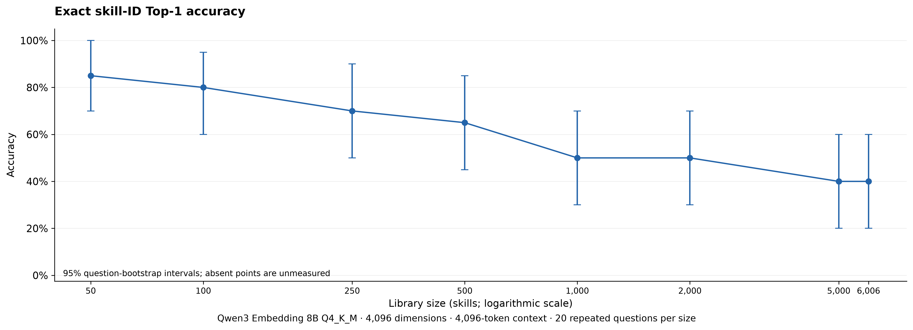
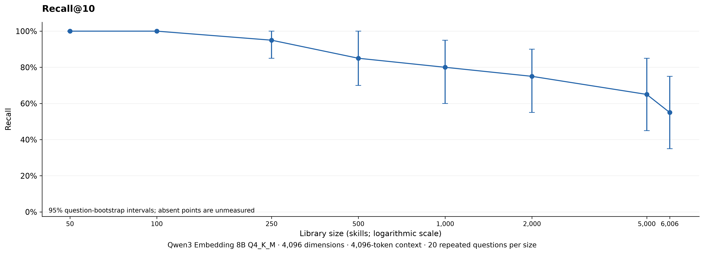
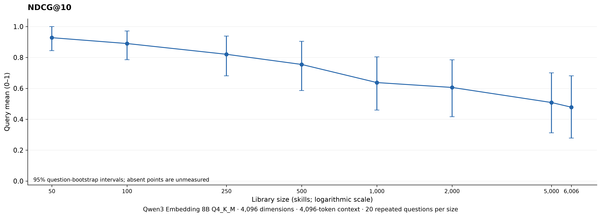
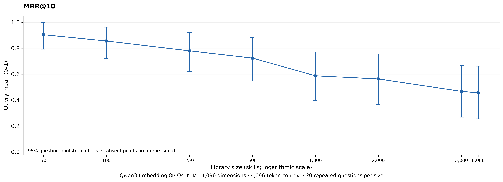
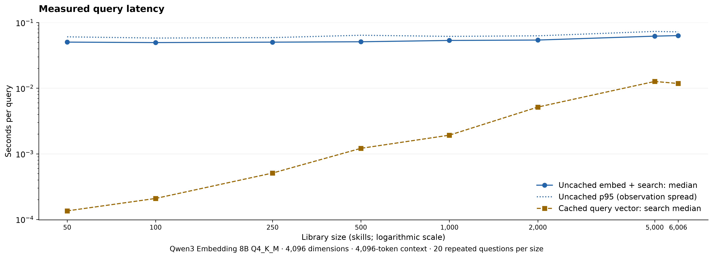
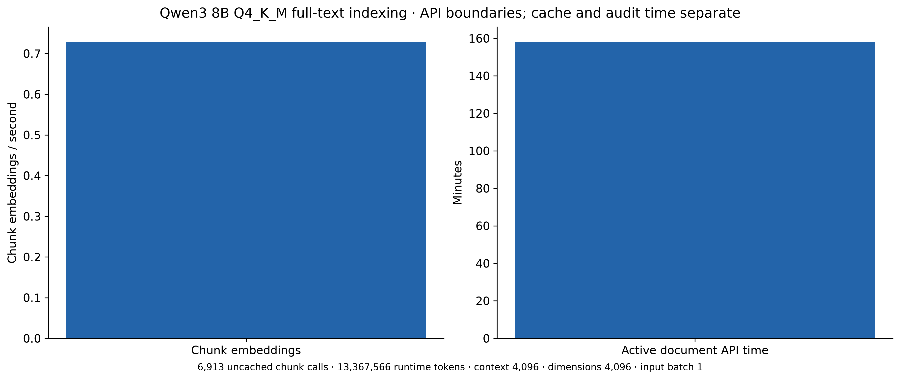
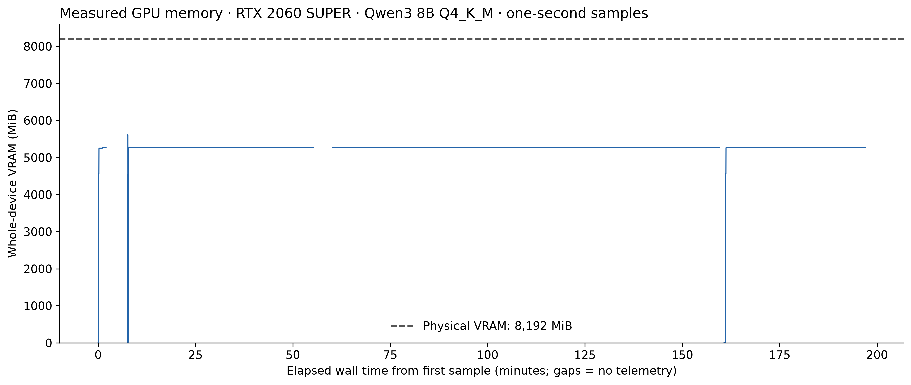
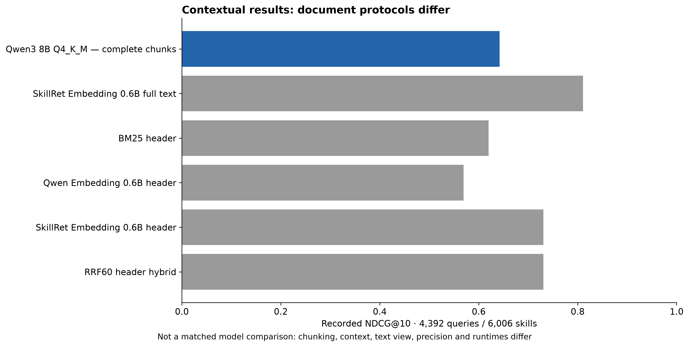

# Qwen3 Embedding 8B Q4_K_M full-text SkillRet benchmark

Execution status: **completed**. 8/8 scaling conditions have saved results. The full 4,392-query evaluation is complete.

This study embeds the entire original skill text. It preserves historical results and uses exact skill IDs, including duplicate names. The optional metadata ablation is unattempted. Lossless document and query vectors are packaged for model-free retrieval replay.

## Scaling results

Each condition contains the same 20 exposed, single-positive questions. Missing conditions have no measured score.

| Skills | Top-1 ID accuracy | Recall@10 | NDCG@10 | MRR@10 | Incorrect Top-1 |
|---:|---:|---:|---:|---:|---:|
| 50 | 0.850 | 1.000 | 0.928 | 0.904 | 3 |
| 100 | 0.800 | 1.000 | 0.890 | 0.856 | 4 |
| 250 | 0.700 | 0.950 | 0.821 | 0.780 | 6 |
| 500 | 0.650 | 0.850 | 0.755 | 0.724 | 7 |
| 1,000 | 0.500 | 0.800 | 0.638 | 0.587 | 10 |
| 2,000 | 0.500 | 0.750 | 0.606 | 0.563 | 10 |
| 5,000 | 0.400 | 0.650 | 0.508 | 0.467 | 12 |
| 6,006 | 0.400 | 0.550 | 0.478 | 0.456 | 12 |

Unmeasured library sizes: none.

## Official full-catalog evaluation

| Metric | Query mean | 95% question-bootstrap interval |
|---|---:|---|
| NDCG@10 | 0.642091 | [0.631892, 0.652435] |
| Recall@10 | 0.701389 | [0.690991, 0.711976] |
| MRR@10 | 0.732295 | [0.720881, 0.743921] |

All 4,392 queries and 7,187 binary qrels contribute to the denominator. Additional NDCG/MAP/Recall/Precision at 5/10/15 and coverage at 20/50 are in [full_evaluation.json](results/full_evaluation.json).

## Corpus, chunking and reproducibility

The input audit covers 6,006 skills, 13,244,559 original tokens (mean 2205.22; median 1677.0; maximum 49,011). There are 726 chunked skills and 6,913 chunks, totaling 13,360,655 tokenizer tokens including overlap. No body is missing. The audited chunk plan covers 100% of original text; completed embedding coverage is reported separately in content_coverage.json after every skill has been encoded.

Documents are exactly `name + ' | ' + description + ' | ' + skill_md`, preserving original whitespace. Documents up to 4,094 tokenizer tokens use one vector. Longer documents use exact Unicode source slices, 128-token overlap and preferred Markdown section boundaries within the last 256 tokens. Each substring is retokenized and hashed. `/api/embed` uses `truncate:false`, 4,096 dimensions, a 4,096-token context and one input per call. Float32 L2 normalization precedes exact dot-product search. Chunk scores aggregate by maximum; unique skills occupy the top 50. Source text, model digest, chunking/configuration and runtime identify persistent caches outside the repository.

The first maximum-length feasibility probe was safely rejected with HTTP 400 at 4,095 content tokens. The pinned [Ollama admission code](https://github.com/ollama/ollama/blob/v0.40.15/server/routes.go) reserves two admission slots although this GGUF adds one EOS. The final 4,094-token content budget respects that measured boundary without truncation. The retained [failed attempt](results/attempts/01-admission-boundary/failure.json) is separate from completed benchmark outcomes. The [token-batch feasibility measurements](results/feasibility_token_batches.json) test 512/1,024/2,048 token microbatches with one input per call. Their warm maximum-length times were similar, so the primary keeps the lower-memory 512-token microbatch. Input batch size remains one.

A later strict token-count check stopped at 1,680 indexed skills. For that exact full input, the HF audit tokenizer counted 3,411 content tokens, while the native GGUF tokenizer with special-token parsing counted 3,409 plus EOS, exactly matching the 3,410 evaluated tokens. The source contained a control-token spelling that the tokenizers group differently; no source text was truncated. The [retained parity audit](results/attempts/02-tokenizer-parity/native_tokenizer_audit.json) records both parsing modes. The resumed validator checks every nonstandard count against the same model's complete-input native tokenizer before checkpointing. Original-length audit statistics use the pinned HF tokenizer; actual processing totals use Ollama's prompt_eval_count. Model configuration, input text, chunk spans and completed rankings did not change; existing verified vectors were reused.

The strict host swap guard later stopped another invocation after a single additional 4 KiB swap-out, while 4.47 GiB of RAM remained available and no OOM was recorded. The [resource event](results/attempts/03-swap-guard/resource_event.json) preserves that whole-host observation without assigning it to a process. After unloading the benchmark model, the next invocation reused verified caches with unchanged inference settings and unchanged guards. The small swap event remains in telemetry; resetting the invocation baseline does not erase it from the record.

Model digest: `64b933495768fbd3b87c20583d379728a07471e0c66733a9df87cd1901b3c44b`. Runtime: `{'version': '0.40.15'}`. The exact model details, software, GPU/CPU residency and runtime options are retained in model.json, hardware.json, feasibility.json and protocol.json.

The seven historical libraries retain every saved ID and its exact order. The 6,006-skill library uses a separately identified fresh `Random(42).sample` over source order. The historical libraries are not fully nested: completing the 2,000- and 5,000-skill conditions requires cumulative unions of 2,075 and 5,018 distinct skills. Changes across sizes therefore reflect both library size and candidate membership. All conditions restrict the same accumulating corpus index to their exact eligible IDs. All gold IDs are present. Historical gold positions are 1–20; some queries contain names or close lexical hints. Embeddings and scores receive only document/query text, with no gold labels, IDs or position features. Exact score ties use ascending full-text SHA-256; all 6,006 content hashes are unique. These gold-conditioned, exposed pools are not a blinded or unbiased sample of skill discovery.

## Metrics and uncertainty

The tested metric implementation is reused from the official full-text reproduction. NDCG uses linear qrel gains; positive relevance defines hits. AP@K divides by all relevant skills; precision divides by K, including short/missing results. Every expected question remains in the denominator. Scaling uses one exact gold ID, so Hit@K equals Recall@K and MAP@K equals MRR@K. The official test has one to three positives, where these equalities do not hold. Top-1 in the official multi-positive test means the first ID is any relevant ID, not exact-set recovery. Scaling confidence resamples 20 question clusters with replacement and preserves the same sampled question indices across sizes, with 10,000 resamples and seed 42. The 160 repeated cases are never treated as 160 independent questions. Full-test intervals resample 4,392 questions. These intervals describe variation across the exposed question panel; they do not repair selection bias or certify generalization. Perfect observed hit rates can produce degenerate bootstrap intervals. The independent validator recomputes metrics from saved rankings without calling the production metric helper.

## Measured performance

Active document API time: 9486.569 seconds across 6,913 uncached chunk calls and 13,367,566 runtime tokens. Measured active throughput: 1409.1044518438957 tokens/s; 0.7287144926456208 chunks/s. Model cold load: 65.854401473 s (unloaded model, without an OS page-cache eviction). Whole-device sampled peak VRAM: 5614.0 MiB; peak system used RAM: 2.7991790771484375 GiB. Peak GPU temperature: 68.0 °C. One-second telemetry can miss shorter peaks.

The selected 512-token microbatch's indexing/query phase has sampled peak VRAM 5274.0 MiB. The broader monitored startup includes the earlier 2,048-token microbatch residency; its 5,614 MiB measurement is kept separate from steady indexing. The memory figure leaves gaps across unmonitored restart/recovery intervals.

Recorded index stages cover 6,006 unique skills in 9798.675 wall seconds, or 0.6129400428744779 skills/s. Finished stages use elapsed stopwatches; the interrupted stage uses an explicitly marked UTC bracket from the previous scaling artifact's write time to the recorded stop, including boundary serialization overhead. In an unfinished run these totals exclude the active stage; per-call API totals include every completed uncached chunk call. Active API/token totals use successfully journaled responses; requests stopped before checkpointing remain in interrupted wall time, without inferred token counts. The total primary invocation time sums the interrupted and resumed run receipts; recovery pauses and model acquisition are separate.

[performance.json](results/performance.json) and [latency_by_size.csv](results/latency_by_size.csv) retain mean, median, p50, p95 and maximum latencies. Scaling makes a fresh query embedding request at every size and measures total embedding plus search wall time. Cached-query search is a separate repeated search, and is never compared as if it included embedding or generation. Full-test latency records cache hits and component sums separately. Index history and per-call journals distinguish active inference from cache validation, persistence and resumed wall time. Local elapsed compute time is the execution-cost measure; electricity charges are unmeasured and no paid inference is used.

The completed cache-only replay loaded and verified 6,913 document vectors in 7.056 seconds, then reproduced all 4,392 saved rankings with zero model requests. Cached query read-plus-search median/p95: 0.014051 / 0.014390 seconds. This includes cache-file integrity checks, and remains separate from the primary uncached embedding measurements. The operating-system file cache was not evicted, so this does not measure cold-storage reads.

The official test records 4,392 uncached and 0 cached query-vector executions. Uncached total retrieval mean/median/p95/max: 0.250416 / 0.243142 / 0.359622 / 0.665724 seconds. These totals include query cache persistence and search. The summed primary run invocations took 10998.717 seconds, including scaling and the preserved interrupted invocation, with recovery pauses and setup outside that boundary.

## Prior evidence and comparison limits

The recorded SkillRet 0.6B full-text baseline is verified from its saved machine-readable result: NDCG@10 **0.810990**, Recall@10 **0.876442**, MRR@10 **0.856349**. It uses the same pinned corpus, 4,392 queries and official qrels, but strips field whitespace and uses one vector with a 32,768-token cap; its token audit records two truncated documents. The new complete-text max-chunk protocol, quantization and runtime differ, so this is contextual evidence and not exact methodological equivalence or an isolated model-size effect.

The [contextual baseline table](results/contextual_baselines.csv) also reads the saved 4,392-query BM25, Qwen 0.6B, SkillRet header and RRF60 outputs. Those use metadata/header text and 1,024-token neural limits; they are not directly matched full-text controls. The separate 20-query seed-5150 scaling panel differs in questions, nested libraries and relevance, and its scores cannot be substituted for this panel. OAuth/local listing studies use the same current 20 questions and historical pools but descriptions are capped at 300 characters, outputs are name-based generation, and runtime settings differ. Their latency includes generation. They provide context, not a controlled vector-versus-selector model comparison.

## Validation, limitations and status

See [validation.json](results/validation.json) for the exact completed scope. Offline tests check Unicode coverage, boundary behavior, finite unit embeddings, cosine scoring, max-chunk deduplication, out-of-pool exclusions, exact-ID labels, multi-positive denominators and paired bootstrap behavior. Graphs are generated directly from measured JSON/journals, with missing conditions left unmeasured; figures/manifest.json binds chart bytes to sources. Model weights, raw corpus text, original per-text runtime caches, personal paths and credentials stay outside this repository. The requested lossless document/query vector snapshot is included through Git LFS. All raw historical artifacts are preserved. Official qrels define relevance for scoring; a semantically useful but unjudged skill can still count as an error. No blinded-generalization or skill-execution claim follows from retrieval scores. The optional full-text-versus-metadata ablation remains unattempted.

## Published vectors and model-free replay

The lossless [Git LFS snapshot](vectors/README.md) contains all 6,913 document-chunk vectors, all 4,392 official query vectors and all 20 scaling query vectors, plus skill/query IDs, chunk ownership and 7,187 public qrels. Every vector retains its original 4,096 float32 values. The archive is 173,123,948 bytes; [manifest.json](vectors/manifest.json) records archive and uncompressed-array SHA-256 checksums, shapes and dtypes.

The [validated snapshot replay](results/published_vector_replay.json) reproduced all 160 scaling and 4,392 official top-50 rankings and every metric identically, with zero model/API/network requests and zero reads from the original runtime cache. Archive loading and validation took 4.190 seconds; the complete replay took 53.798 seconds on the measured CPU. Run `OPENBLAS_NUM_THREADS=1 python src/vector_snapshot.py replay` after `git lfs pull` to repeat retrieval without embedding the corpus or queries again. This verifies the retrieval evidence; it does not rerun embedding inference or its GPU timing.

## Conclusions

Qwen3 8B Q4_K_M completed full-source retrieval at all eight library sizes and all 4,392 official questions. Its official NDCG@10 is 0.642091, Recall@10 0.701389, and MRR@10 0.732295. Its recorded NDCG@10 is below the contextual SkillRet 0.6B full-text result of 0.810990; this run does not establish a quality benefit from the larger quantized embedding model or from full-source max-chunk retrieval. Within the exposed 20-question panel, exact Top-1 is 85% at 50 skills and 40% at 6,006 skills.

The measured configuration fits this 8 GB GPU with reported full layer offload and documented host buffers. Persistent vector caching supports verified replay without re-embedding the corpus. Max-chunk aggregation gives longer skills more opportunities to score; its effect needs a separate ablation. The missing metadata-only ablation also leaves the effect of adding full skill text unmeasured. Prior baseline scores remain contextual because text handling, context, quantization and runtime differ. These observations support reproducibility and measured retrieval on the pinned public data, with the stated limits on generalization.

## Historical 20-question listing context

The saved OAuth listing outputs below use the same questions and historical eligible pools, with 300-character descriptions and name-level scoring. They are contextual generation results, with a different document view and scoring unit. No controlled model-quality or latency difference is inferred.

| Historical model | Skills | Correct first skill name / 20 |
|---|---:|---:|
| gpt-6-luna | 50 | 17 |
| gpt-6-luna | 1,000 | 13 |
| gpt-6-luna | 2,000 | 13 |
| gpt-6.1-sol | 50 | 18 |
| gpt-6.1-sol | 1,000 | 13 |
| gpt-6.1-sol | 2,000 | 14 |
| gpt-6.1-terra | 50 | 17 |
| gpt-6.1-terra | 1,000 | 13 |
| gpt-6.1-terra | 2,000 | 14 |

The [machine-readable context](results/contextual_listing_baselines.csv) preserves source hashes. The [local native listing study](../skill-discovery-local-native-20261103/COMPARISON.md) additionally has parser/context/KV differences and retains its blocked conditions; its generation timings must remain separate from cached or uncached vector search.
