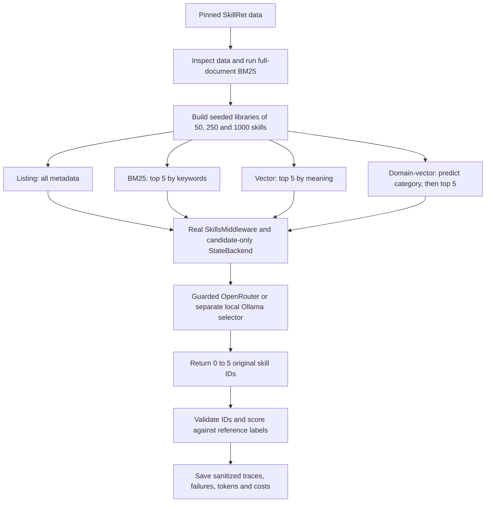

# How the pilot works

The experiment measures **skill selection**, not whether a selected skill can
perform a task. Each request is evaluated independently.

Reference labels are withheld from the **model**. The pilot uses consumed
exploratory queries rather than untouched final-test queries. Labels are used by the
experimental sampler to retain relevant skills, and later by the evaluator. The
4,192 reserved final query IDs are not used for prompt development.

## Retrieval and selection are different stages

`pilot.baseline()` uses the full original skill document for the first BM25
reference. `trial.vectors()` constructs a common name/description representation,
capped to 1,024 characters and 128 BGE tokens. All four selection methods use that
same metadata. The body is absent from the main model prompt.

`select_candidates()` picks the shortlist. The domain router receives only the
canonical request and six category descriptions. An empty category stays empty;
there is no hidden global-search fallback. Candidate display order is seeded and
independent of retrieval rank and relevance.

## Native loading and tool isolation

`run_agent()` creates real `SkillsMiddleware`, `StateBackend` and `create_deep_agent`
objects. Candidate files exist only at `/skills/s-<UUID>/SKILL.md` in memory. Their
unique frontmatter prevents duplicate readable names from overriding each other.
The host filesystem and noncandidate skills are not mounted.

Passing `tools=[]` is insufficient to disable Deep Agents' built-ins. The harness
profile disables the default subagent, summarization and main-mode `read_file`;
middleware checks the effective tools and denies unoffered tool execution. Main
selection has one model call and a terminal `select_skills` action.

Activation is a **separate** smoke check: at most four model calls and two bounded
native reads, plus selection. It establishes progressive disclosure only. No shell,
downloaded script, linked resource or skill instruction is executed.

## Budget and resume behavior

Every paid model call passes through `GuardedModel` and `Budget.reserve()`. A file
lock covers the request, and a conservative reservation is written before network
generation. Both USD and estimated CAD limits must pass. SDK retries are disabled.
Returned costs settle the reservation; missing/ambiguous costs keep it outstanding.

Hashes identify dataset, representation, code, prompts and provider settings.
Only exactly matching cases are reused. Failed outputs are preserved rather than
retried for a better answer. Comment/formatting changes also alter code hashes;
the archived original run remains the evidence for the recorded measurements.

Tests use scripted models and mocked HTTP only to verify plumbing. Their outputs
are never counted as semantic benchmark performance. Saved live results have
their own IDs, usage and sanitized wire traces.
