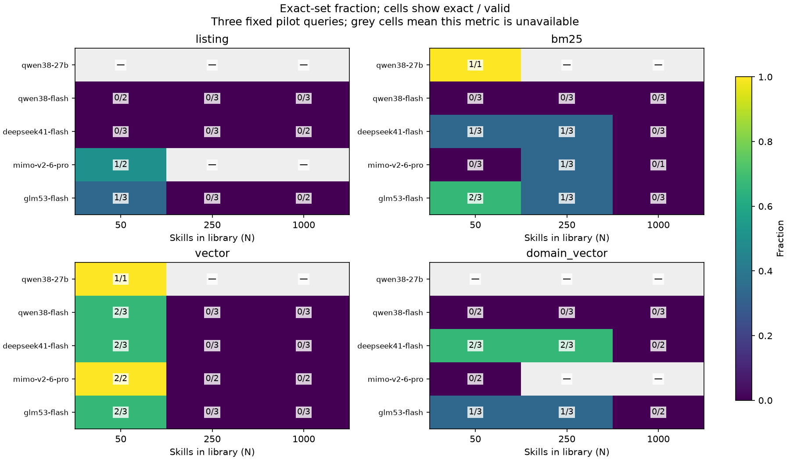
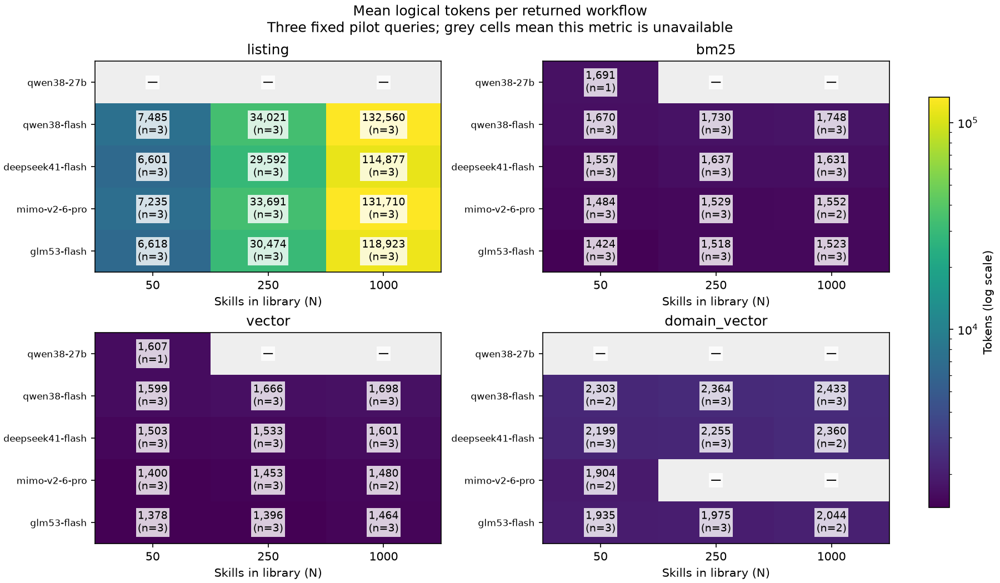
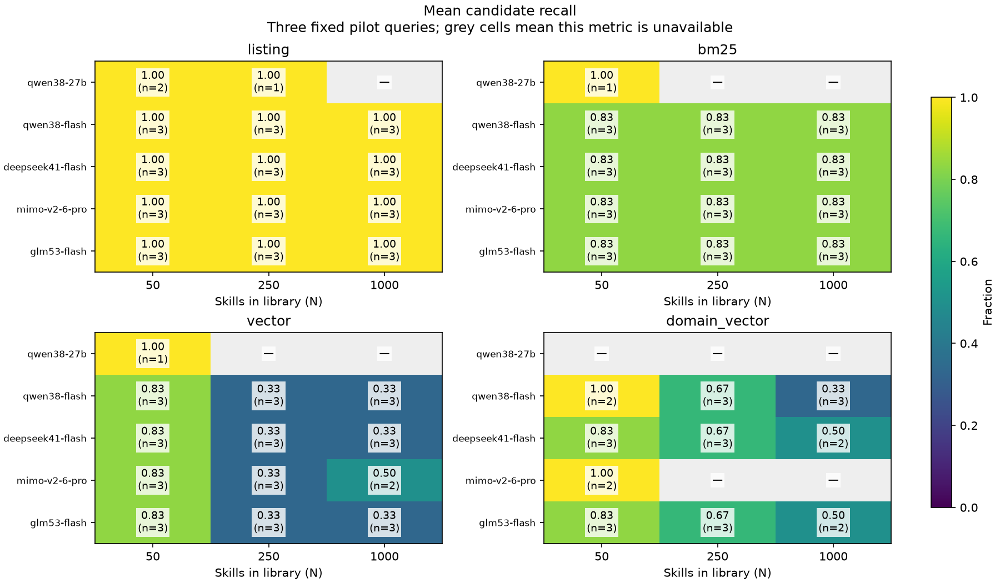

# OpenRouter scaling benchmark: measured results

**121 valid selections and 24 exact matches from 138 attempted cases; 180/180 planned cases recorded.** Five fixed models, three existing pilot queries (two single-positive, one multi-positive), N=50/250/1000, and four methods. 53 N=50 records were explicitly reused, including failures; the added sizes are new live calls through real Deep Agents SkillsMiddleware and candidate-only StateBackend.

| Model | N | Listing exact/valid | BM25 exact/valid | Vector exact/valid | Domain-vector exact/valid | Attempts/planned |
|---|---:|---:|---:|---:|---:|---:|
| qwen38-27b | 50 | — (0 valid) | 1/1 | 1/1 | — (0 valid) | 4/12 |
| qwen38-27b | 250 | — (0 valid) | — (0 valid) | — (0 valid) | — (0 valid) | 1/12 |
| qwen38-27b | 1000 | — (0 valid) | — (0 valid) | — (0 valid) | — (0 valid) | 0/12 |
| qwen38-flash | 50 | 0/2 | 0/3 | 2/3 | 0/2 | 11/12 |
| qwen38-flash | 250 | 0/3 | 0/3 | 0/3 | 0/3 | 12/12 |
| qwen38-flash | 1000 | 0/3 | 0/3 | 0/3 | 0/3 | 12/12 |
| deepseek41-flash | 50 | 0/3 | 1/3 | 2/3 | 2/3 | 12/12 |
| deepseek41-flash | 250 | 0/3 | 1/3 | 0/3 | 2/3 | 12/12 |
| deepseek41-flash | 1000 | 0/2 | 0/3 | 0/3 | 0/2 | 11/12 |
| mimo-v2-6-pro | 50 | 1/2 | 0/3 | 2/2 | 0/2 | 11/12 |
| mimo-v2-6-pro | 250 | — (0 valid) | 1/3 | 0/2 | — (0 valid) | 9/12 |
| mimo-v2-6-pro | 1000 | — (0 valid) | 0/1 | 0/2 | — (0 valid) | 8/12 |
| glm53-flash | 50 | 1/3 | 2/3 | 2/3 | 1/3 | 12/12 |
| glm53-flash | 250 | 0/3 | 1/3 | 0/3 | 1/3 | 12/12 |
| glm53-flash | 1000 | 0/2 | 0/3 | 0/3 | 0/2 | 11/12 |

These are conditional exact-set counts, not accuracy on a common valid denominator. Invalid outputs, context exclusions, provider pauses, and gating reduce coverage. Missing results are never filled with invented successes or treated as successful empty selections. All denominators and precision/recall/F1 are in [CSV](OPENROUTER_SCALING.csv); [single/multiple-positive strata](OPENROUTER_SCALING_SINGLE_MULTI.csv) remain separate.

At N=1,000, **0/35 valid decisions matched the complete annotated set**. However, 22/35 included at least one annotated skill, and 34/35 included IDs outside the annotated set. Low exact-set accuracy therefore does not mean no relevant skills were found. These extra IDs are false positives under the pinned qrels, not proof that those skills are useless in practice. The sample and differing valid denominators do not support a general model ranking.

## Cost and provenance

This expansion made **89 additional reserved attempts**, costing **US$0.337920690**. Whole-project ledger: **US$0.386496410**, estimated **CAD$0.579744616** using the declared 1.50 planning factor. 236/300 attempts; unresolved reserve US$0.000000000. Provider-returned costs, request IDs and raw sanitized traces are saved. Zero-charge rejections require explicit reconciliation. USD3/CAD5 ceilings remain unchanged.

| Model | New returned generations | Additional actual USD |
|---|---:|---:|
| qwen38-27b | 0 | $0.000000 |
| qwen38-flash | 25 | $0.079275 |
| deepseek41-flash | 23 | $0.016747 |
| mimo-v2-6-pro | 16 | $0.222004 |
| glm53-flash | 23 | $0.019895 |

The original pre-credit full-document BM25 baseline remains **Recall@5 = 0.516667**, across **200 fixed queries / 6,006 skills**, at dataset revision `6583d7d2ed07644d0fb8938ed8178f3a7dc42a12`. It is a different representation and denominator from this metadata-only selection study and is not a published-score reproduction.

## Protocol and limits

The three query IDs (q-04792, q-04981, q-03911) were fixed before this expansion to fit the remaining shared request cap. The full 20-query × three-size × four-method × five-model sweep would require 1,200 selectors plus routers; it was not run. No final-holdout queries were consumed. Gold-preserving nested libraries and stable display order are identical across models/methods. Listing coverage is 1 by construction. No prompt or output repair was introduced.

Each model retains its prior provider, temperature0, 512-token output cap, 96-token router cap, 90-second timeout and fixed UUID clarification. GLM requests low reasoning; the other models request none. Current public endpoint metadata was refreshed before calls; no fallback occurs. A passing native canary and earlier valid SkillRet selections establish integration. Invalid benchmark outputs are outcomes, not grounds to re-sample for correctness. Domain-vector still requires valid listing/BM25/vector outputs for that query and N, which creates selection bias in its conditional score.

Existing matching N=50 decisions and query-only domain routes are reused with explicit source case IDs. Logical domain tokens/cost include the router for each workflow; physical costs deduplicate requests and include only newly charged calls in the expansion table. Candidate recall measures retrieval coverage separately from selection. Strict byte-based context preflight can conservatively exclude listing even if a tokenizer-specific count might fit; no truncation or hidden summarization occurs.

Three synthetic queries cannot establish general superiority or a statistically reliable scaling curve. Differences in reasoning, hosted provider quantization and cache state also limit model comparisons. Actual native reads were already demonstrated separately: the preceding five-model activation study recorded 16 reads across 25 cases, including four real SkillRet candidate reads. No additional activation calls or downloaded skill execution are part of this scaling study.







## Failures and blocked work

- TooManyRequestsResponseError: Provider returned error: 4 cases.
- selector_prerequisite_failed: 10 cases.
- provider_paused_after_failure: 32 cases.
- unknown_ids: 13 cases.

Unknown IDs and malformed selections are retained. A transport failure pauses that provider's remaining new cases in this batch; saved prior cases stay available. Ambiguous billing stops all further paid work until reconciled. Read [failure rows](OPENROUTER_SCALING_FAILURES.csv) and the raw traces before interpreting the conditional scores.

## Resume and review

```bash
.venv/bin/python scripts/benchmark_openrouter.py --live
.venv/bin/python scripts/report_scaling.py
.venv/bin/python scripts/audit_scaling.py
.venv/bin/python scripts/verify.py
.venv/bin/python pilot.py package
```

The live command requires the private key and ALLOW_PAID_RUNS=1 and reuses existing cases. Report/audit commands make no model calls. The two notebooks default to saved results/offline checks. A model pause is retained; changing provider or retry policy requires an explicitly separate protocol, not deleting the ledger.
